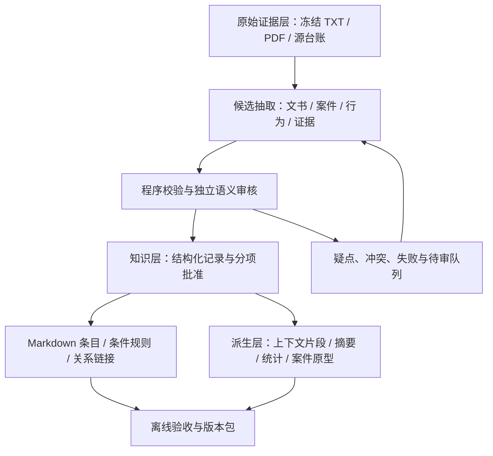

# FinRisk：基于教材第三章的离线知识库重建详细规划

> 项目：`C:\Users\11051\Desktop\金融比赛\复赛\FinRisk_复赛改进`。
> 教材：《深入理解 AI Agent：设计原理与工程实践》v2.0，第三章“用户记忆和知识库”，书内第 72–101 页。
> 范围：按用户选择，只规划离线知识库重建。在线风险判断、API、默认业务库切换和在线 Agent 功能不列入实施任务。
> 本文区分“本次实际核查”“历史记录”和“拟议方案”。任务与质量目标尚未实施，不是本次重建成绩。规划日期：2026-10-09。
> 执行说明：以后按任务顺序实施，每项先准备能暴露真实错误的检查样例，再实现最小改动并验收；知识内容仍按既有分项人工批准规则处理。

## 1. 建议采用的路线

**以已冻结官方原文为证据，以“文书—受罚主体案件—独立行为—逐字段证据”为主数据，先稳定抽取和审核，再生成规则卡、层次概览、关系索引和上下文感知片段。**

教材的关键启示是：高质量知识库的主要工作发生在索引之前。把旧摘要换个格式、切成更多块或生成更多向量，不能补回被漏掉的主体、否定、条件和责任关系。（3.3，第 87–88 页）

| 路线 | 做法 | 对本项目的判断 |
| --- | --- | --- |
| A：复用证据与已批字段，分层修复 | 保留冻结原文、v4 批准范围、永久 ID 和有效检查器；存量分流复核；新增知识分阶段派生 | **推荐**。利用现有积累，同时阻止旧语义错误继续传播 |
| B：所有内容从零重新抽取 | 忽略旧稿，从每份原文重新生成全部字段 | 容易重复消耗，且重新生成不自动更准确；只用于无法局部修复的文书 |
| C：先全量做向量／图谱／聚类摘要 | 优先增加索引与关联算法 | 应放在内容达标之后；否则错误事实会同时污染摘要、图谱和索引 |

建议把本次重建分为两个离线交付层级：

1. **必须完成的核心**：证据台账、正确分案、行为卡、标签与场景依据、条件和未知、真实审核、覆盖与质量报告、自包含版本包。
2. **依赖核心质量的增强**：上下文感知片段、Markdown 导航、规则卡、可计算统计、带证据的关系索引、案件原型；完整 RAPTOR／GraphRAG 和本地向量实验按收益条件决定。

“不遗漏书中方法”在这里意味着逐项给出落点、依赖和取舍，不意味着把所有框架都安装一遍。第 16 节覆盖第三章全部主要方法；第 17 节映射全部 12 个实验。

## 2. 当前资产与质量缺口

### 2.1 本次实际核查结果

以下是本次读取实际文件得到的统计，不沿用 README 的完成度表述：

| 资产 | 实际数量／状态 | 重建时怎么使用 |
| --- | --- | --- |
| 官方原件 | 9,999 TXT、10,000 PDF | TXT 为当前语义入口；PDF 用于定向核查，不把两个载体计成两个独立案件 |
| 全量预处理冻结 TXT | 9,999 份 | 本次逐文件 SHA-256 与官方 TXT 核对，全一致，可复用 |
| 来源台账／文书索引 | 19,999 行／9,999 行 | 作为资产集合和处理覆盖的起点；历史处理状态需要重新归并 |
| 官方风险 CSV | 27 类 | 冻结原文件和 SHA，风险名称以 `risk_tag` 列为准 |
| 旧默认案例库 | 7,628 案，全部 `active`；7,617 `auto_checked`、11 `unreviewed` | 保留作历史对照；不能整体迁成“人工已审核核心” |
| v4 样板 | 27 文书、53 案、70 行为卡、627 证据、11 责任关系 | 复用已批准字段、对应源值与永久 ID；不扩大批准范围 |
| v4 行为状态 | 70 卡 fact/tag/scene 均 `approved`，publication 均 `candidate` | 分项批准与发布分别保留 |
| v4 案件状态 | 53 案整体事实状态仍 `pending` | 行为批准不等于案件元数据、身份和全部事实已审 |
| v4 证据定位 | 本次检查 627 条区间、文本版本和文本 SHA，全部通过 | 只证明与冻结文本对应，不证明每条引用支持其绑定语义 |
| 旧模型草稿 | pilot 100＋bulk 698＝798，两个集合无交集 | 待审线索，按保留、修复、重抽、隔离分流 |

v4 的 82 项逐标签依据中，63 项 `source_context_only`、18 项 `conditional_transfer`、1 项 `insufficient`；70 张卡的观测场景中，63 项 `direct_evidence`、7 项 `clue_only`。**已批准“场景仅有线索”，仍然只代表线索，并不升级为真实场景。**

实际核查报告保存在本次工作区 `work/finrisk/asset_inspection.json` 与 `source_verification.json`。检查没有调用模型，也没有执行项目构建或改变原项目文件。

### 2.2 历史记录中需要继续核实的内容

项目 [HANDOFF.md](C:/Users/11051/Desktop/金融比赛/复赛/FinRisk_复赛改进/HANDOFF.md) 记载：独立 API 首轮 10 份原始草稿机械通过为 0/10；随后离线补正出 10 份待审稿；与旧 798 份合计 808 份候选，尚有 9,164 份没有候选稿。这些处理阶段不能合并成一个“通过率”。本次已读取补正报告并确认 `quality_hold.json` 仍为 active，但没有重新运行生成和那 38 项历史测试。

历史预处理报告记录：11,480 个机械块、147,548 个候选提及；PDF/TXT 映射为单候选 6,420、多候选 158、未解决 3,421。**候选提及不等于已抽取事实；单候选映射不等于 PDF/TXT 已核对一致。**实施第一步应重新计算集合和任务去向，不能靠历史断点推算剩余工作。

### 2.3 需要针对性修正的已有实现

| 代码／资产 | 本次看到的行为 | 重建要求 |
| --- | --- | --- |
| [preprocess_rules.py](C:/Users/11051/Desktop/金融比赛/复赛/FinRisk_复赛改进/build/kb_full_preprocess_v1/preprocess_rules.py:120) | `segment` 默认按 900 字符和附近标点做机械切分，明确不是行为划分 | 复用位置与覆盖线索；另建案件／行为感知的知识片段，不把字符数当 token 数 |
| [case_ingestion.py](C:/Users/11051/Desktop/金融比赛/复赛/FinRisk_复赛改进/src/offline/case_ingestion.py:426) | 旧 `_build_chunks` 使用 `full_text.find` 定位汇总文本；找不到时是 normalized | 新证据定位枚举所有精确匹配，用前后锚点消歧；概括与逐字证据分开 |
| [case_ingestion.py](C:/Users/11051/Desktop/金融比赛/复赛/FinRisk_复赛改进/src/offline/case_ingestion.py:483) | 旧扩展表达可能来自 `llm_or_rule` | 不当真实销售原话；默认不进入已审核表达集合 |
| [case_repository.py](C:/Users/11051/Desktop/金融比赛/复赛/FinRisk_复赛改进/src/storage/case_repository.py:387) | 历史兼容逻辑允许 active 的 legacy 记录被检索 | 新离线核心按本次质量门槛导出，不继承 legacy 的兼容放行 |
| [draft_checks.py](C:/Users/11051/Desktop/金融比赛/复赛/FinRisk_复赛改进/build/kb_kimi_batches_v1/draft_checks.py:15) | 已有结构、逐字引用、标签、场景及状态检查 | 先提取为可复用检查模块，保留严格标准；另加语义审核与全文遗漏检查 |
| [rerank_context.py](C:/Users/11051/Desktop/金融比赛/复赛/FinRisk_复赛改进/src/application/rerank_context.py:24) | 给重排输入补同案事实 | 这是运行时重排背景；本次需在离线生成片段时保存可追溯前缀，不能混为已实现 Contextual Retrieval |

## 3. 离线知识库的目标架构

教材第 92 页的三层分离可在本项目中这样实现：



### 3.1 主数据先用 JSONL，不急于换数据库

已有结构契约选择 UTF-8 JSONL＋冻结全文，适合当前本地批处理、差异审核和交付。建议继续沿用：

- **JSONL 是字段与状态的权威表示**；经过验证的 JSONL 生成可阅读 Markdown。
- **Markdown 是同版本的阅读投影**；人工修订应形成字段级变更提案，再回写主数据并重建投影，避免两份事实各改各的。
- SQLite 可以只承担任务调度、ID 注册或统计查询的派生视图；不要求新增向量数据库服务。
- 原件和审批历史只追加或增加新版本；改写发生在候选与知识表达层。

### 3.2 拟议版本目录

以下均为以后实施时新建的路径，当前项目里尚未创建。相对路径以项目根目录为基准。

```text
outputs/知识库教材重建_v5/
├─ manifest.json
├─ dictionary/                 # 冻结风险字典、六场景与用途枚举
├─ evidence_sources/           # 冻结 TXT；实际核查用到的 PDF/图像及源清单
├─ data/                       # 结构化主数据、责任关系、变更与审核
├─ staging/                    # 未通过定位或结构检查的候选
├─ knowledge/
│  ├─ index.md                 # L0 全局入口
│  ├─ taxonomy/                # 官方风险类型与已审核机制的导航
│  ├─ cases/                   # 文书/案件概览及回源链接
│  ├─ behaviors/               # 可阅读行为卡
│  ├─ rules/                   # 有条件和例外的规则卡
│  └─ topics/                  # 跨案例主题概览
├─ derived/
│  ├─ retrieval_units.jsonl
│  ├─ links.jsonl
│  ├─ summaries.jsonl
│  ├─ statistics.json
│  └─ prototypes.jsonl
├─ reviews/                    # 提案、差异、审核意见、真实批准
├─ reports/                    # 覆盖、质量、缺口、回归与资源用量
└─ issues/                     # PDF映射、冲突、未知、待审与隔离
```

每次冻结交付为一个不可覆盖的版本目录。共享原件存储时，版本包必须有可恢复的依赖清单；对外展示包另导出脱敏视图，不能把缺失的外部原件引用称作自包含。

## 4. 主数据模型：保留八张表，再补关联与派生物

以已有 [结构与验收契约](C:/Users/11051/Desktop/金融比赛/复赛/FinRisk_复赛改进/outputs/Kimi知识库重建提示词_v1/04结构与验收约定.txt) 为起点，不重新发明一套不兼容主表。

| 对象 | 必须保留的内容 | 本次加强点 |
| --- | --- | --- |
| source_inventory | 文件身份、原路径、SHA、载体、映射、处理去向 | 每份来源都有最终去向；副本、重复来源与独立事件分别计数 |
| documents | 文本 ID/版本/SHA、完整正文、解析方式、段落/页码映射 | 原字节与解码后文本的哈希含义分开，保留真实换行 |
| cases | 一个受罚主体的决定、文号、处罚、日期、行为引用、逐字段证据 | 机构与个人分案；事件关联需证据；法定代表人不自动成为受罚人 |
| behaviors | 独立机制、实施者、对象、动作、背景、认定、条件/例外/未知 | 事实、标签、场景分别审；缺具体机制的案由卡保留使用限制 |
| evidence | 连续逐字引文、文本版本、字符区间、用途、支持字段 | 区间正确与语义支持分开；多段事实用多个证据，不拼接成假引文 |
| annotations | 概括、解释、标签依据、场景迁移建议、来源属性 | 区分 source_summary、分析、推断与合成；新概括不能借旧事实批准 |
| materials | 实际材料载体、用途、真实表达、完整性 | 处罚记载有录音不等于获得完整录音；真实原话与监管概述分开 |
| reviews | 对象、字段范围、源值版本、决定、审核人、时间和原始记录 | 分开机器检查、模型复核、人审及发布；批准只继承完全一致的范围 |

补充对象分两组：

- **主数据关联**：继续使用 `responsibility_relations`、`retired_behaviors`、`unresolved_references`；新增关联只能记录经证据确认的关系，不凭同名、同机构或相邻文书号合并。
- **派生对象**：`retrieval_units`、`links`、`summaries`、`statistics`、`prototypes`。都记录输入记录版本、依赖 ID、配置版本、生成方式和审核范围；依赖改变时失效重建。

### 4.1 通用元数据与状态

所有知识及派生记录建议具有：`record_id`、`record_version`、`source_ids`、`evidence_ids`、`origin`、`review_scope`、`validity_status`、`created_at`、`supersedes`、`access_scope`、`dependency_ids`。

时间至少分开：行为发生时间、处罚决定时间、材料取得时间、知识版本时间、规则适用时间。文号年份不能补造成处罚日期；处罚历史记录不会因为日期久远自动失效。历史法条原引用与当前效力分开，未另行核验时写“现行效力未知”。

未知采用 `null＋missing_reason` 或显式未知枚举；不能把“未提到”编码成否，也不能把不确定场景编码成所有场景。

状态应保留多维，而非统一的一个 approved：

1. 定位状态：引文是否与指定文本版本逐字对应。
2. 结构状态：类型、ID、引用和枚举是否通过。
3. 语义状态：事实、角色、标签、场景及摘要分别是否支持。
4. 人审状态：谁批准了哪些字段与源值。
5. 交付状态：candidate、按声明范围的 approved_core、隔离或暂缓。

例如 v4 的 C393：行为卡 B-C393-01 已批准“仅有欺骗投保人案由、机制不足、渠道仅线索”。其 `scene_scope=insufficient` 是应保留的正确限制，不是待模型自动补全的缺陷。

### 4.2 从数据中发现因子，形成核心＋扩展 schema

教材实验 3-12 的自下而上 schema 发现，适合本项目，但官方 27 类风险标签保持冻结。新发现只增加机制因子或辅助维度，不能改官方风险类型。（第 98–99 页）

步骤是：选 60–100 份分层发现样本 → 对照全文列出已存在的关键因子及证据 → 合并同义因子 → 区分通用与专项字段 → 评审后冻结 schema → 在未参与发现的材料上检验可用性。数量是拟议起点，取决于真实分层数量，不是要求模型凑齐字段。

| 模块 | 拟记录因子举例 | 缺失处理 |
| --- | --- | --- |
| 通用核心 | 主体、角色、动作、对象、时期、原认定、证据充分性、材料用途 | 未披露为未知；角色不能从职位推定 |
| 收益／分红表达扩展 | 历史还是未来、是否确定性保证、产品条件、演示口径、原文澄清 | 合同或演示制度没提供时不能补产品事实 |
| 限时限量扩展 | 对外宣称、实际销售状态、规模条件、制造紧迫性的方式 | 只有“停售”词而无真实状态，不补虚假性 |
| 回访／电销扩展 | 是否真实接触客户、代答/改号/录音操作、授权、时间顺序 | 原文缺实际通话时保留，不生成通话稿 |
| 费用／利益扩展 | 资金来源、流向、支付名目、真实交易、受益对象、合同内外条件 | 虚列不自动推出套取，赠礼不自动推出合同外利益 |
| 个人责任扩展 | 直接实施、管理责任、其他责任、关联机构行为及证据 | 未证直接实施时，仅登记明确责任关系 |

用模块化 schema 保留少量必需字段，避免要求所有行为填满所有专项模块。行为因子数据足够后才开展聚类和重要性分析。

### 4.3 区分内容详细度与可使用范围

建议给卡片增加独立的内容详细度和用途资格，而不以字数或 approved 单字段决定所有用途：

| 内容层级 | 能保留的知识 | 不能自动获得的用途 |
| --- | --- | --- |
| 详细事实与条件充分 | 可追溯机制、原话/概述、条件、差异；按批准范围供规则提炼 | 仍不代表适用于所有产品、时间和场景 |
| 只有监管案由／概述 | 历史原认定、主体与已披露结果；明确机制不足 | 不用于详细机制匹配或无条件跨场景迁移 |
| 个人只有责任与处罚 | 明确责任关系、受罚结果与来源 | 不虚造亲自实施行为，不与机构操作事实合并 |
| 证据／归属仍有问题 | 候选线索、错误和待补资料 | 不进入已审核用途视图 |

例如 `approved_core` 应同时声明是历史事实、原话引用、机制参考还是规则使用视图；依赖的身份、证据与必要条件也要达到该用途的核验和批准要求。只批准行为中的某些字段，不得把整个案件或所有派生物都设为 approved。详细度不足且限制正确的卡是有价值的历史知识，不能为提升“完整率”人为补造细节。

## 5. 第一阶段：冻结来源与重新计算处理台账

### 5.1 源文件不重新清洗覆盖

复用全量冻结 TXT 与现有台账。原文留原字节；用于阅读、分词或金额解析的规范化文本另存投影及映射。证据定位只对约定的冻结文本版本计算。

编码约定写清：原字节 SHA、解码规则、是否剥离 BOM、换行保留规则、解码后文本 SHA；区间用 Python Unicode code point 半开区间 `[start,end)`。浏览器 UTF-16 偏移如用于预览，应显式转换，不能共用含义不明的 `start`。

去重至少区分：

- 同一文件的重复导入：可以复用同一源版本。
- TXT/PDF 两种载体：有已确认对应关系才关联，候选不得自动合并。
- 同一事件的公司／个人处罚：关联事件，保留各自案件与处罚。
- 正文相似或相同、来源与权限不同：保留各自来源；归并只能形成经审核的关系。

### 5.2 每个来源都有去向

以 9,999 TXT 的实际集合为处理分母。每份可记录多阶段状态，但总览的互斥主去向统一为：未处理、处理成功、部分完成、失败隔离、经审排除、确认重复关联。各去向之和必须等于该批目标集合。

案件数、行为数和证据数是处理结果，不能预设“必须得到一万案”。非保险、仅有处罚无行为、正文不足都可以不形成行为卡，但需保存源级分类证据和原因。

### 5.3 PDF 定向核查

优先检查：多主体或处罚金额异常、表格错列、极短正文、非法日期、同名歧义、重复引用、TXT/PDF 多候选，以及人审提出的疑点。利用已有 PDF/OCR/表格提取组件，保留页码、区域和人工核查记录。

不对所有 PDF 立即重新 OCR；也不凭文件名把所有映射标 verified。若 TXT 与 PDF 矛盾，保留两个来源版本及冲突，不改掉 TXT 来伪装一致。只有实际看到对应页面，才填写页码与图像定位。

本阶段验收：集合闭合、冻结文本可回源、源版本明确、异常有去向；PDF 未核范围如实列出。

## 6. 第二阶段：稳定“全文到行为卡”的抽取

### 6.1 模型与程序分工

| 程序负责 | Agent／人工负责 |
| --- | --- |
| SHA、解码、字符位置、精确引用匹配、稳定 ID、外键、枚举、金额计算、断点和清单 | 保险相关性、正确分案、行为拆分、主体归属、事实/申辩/认定区分、机制因子、标签依据、场景/用途、遗漏与条件 |

机械候选只减少搜索成本，不限制 Agent 只能看到预选片段。短文提供完整原文；长文先建立段落／主体／决定覆盖清单，按语义部分处理并允许读全文和邻段，最后全篇核对归属与遗漏。

建议抽取分三次逻辑阶段，可在同一 Agent 工作流程内完成，不要求固定三次付费调用：

1. **文书与案件骨架**：识别各受罚主体及各自决定，区分负责人、关联人和受罚人；登记全部事实段、处罚段、申辩和认定。
2. **事实与行为**：一张卡表示一个独立机制；保留共同背景，拆分可独立成立的行为；只承担责任的个人可以没有直接实施行为卡。
3. **知识补充**：在事实已有证据后给标签、观测场景、用途、条件/例外/未知及解释；无法支持的内容保持待审。

独立 Reviewer 按全文段落检查“该段去哪了”。`document_coverage` 不只是写“全文已读”，而是将有业务意义的段落映射到案件、行为、证据、程序性文字、排除原因或未解决事项，重点识别未入卡的违规事实。

### 6.2 用代表性小样冻结标准

先精做 10 份代表文书，再扩展到 30 份独立新材料验证。覆盖以下类型，允许一份覆盖多个类型：

- 简短公开表／仅案由、无具体机制。
- 公司与个人多主体、多项决定。
- 一主体多行为、共享背景或仅责任个人。
- 真实销售原话及明确的原文澄清。
- 培训、电销、回访及后台录音／资料事实。
- 跨行金额、多个金额、申辩与监管不采纳。
- 稀有机制、零标签、标签必要条件不足。
- 长文／表格／需要 PDF 核查。

v4 和补正 10 份用于样板与错误回归；它们已经参与规则改进，不能充当新独立样本。另选的 30 份不得由旧参考摘要泄露答案。

### 6.3 标签、场景、用途和表达的具体规则

风险标签逐字属于官方 CSV；默认 1–2、最多 3，允许 0 个。每个标签单独记录本行为事实、理由、证据、必要条件及适用范围；0 标签不表示合规。已证违规但无具体类时才按证据提出“其他”候选。

六场景沿用项目 `ST1`–`ST6`，是业务输入分类，不能称为官方风险类型。分开记录：原文实际场景、渠道线索、材料载体、产品类型、材料用途、跨场景建议。培训／电销／回访保留子类型。

用途使用已有枚举：direct_promotion、employee_instruction、prohibition_reminder、risk_education、fact_description、unknown。出现“不得保证收益”不当作直接承诺；转折或混合用途逐分句检查。**未受处罚的材料或禁止性提醒，也不能据此单独宣布整份材料合规。**

真实表达要求连续原文引文，并记录说话者、上下文、是否直接引语、是否取得完整业务材料。监管概述可以是有效事实来源，但不能改写成引号里的客户话术。合成表达单独保存，首版不批量生成，也不纳入事实、人审核心或独立金标。

### 6.4 证据的双重验收

程序验收：`verbatim == documents.full_text[start:end]`，文本版本和 SHA 匹配，引用存在且归属一致；重复出现必须通过锚点消歧，匹配失败进 staging，不能自动模糊修成“verified”。

语义验收：这段话是否真的支持该字段，是否属于本主体，是监管认定还是当事人申辩，是否保留时间、否定与限制。真引用可能只是法条或处罚段，不能替代未披露的行为事实。

金额保留原文、数字值、单位、币种来源和限定词。跨行“二\n十一万元”不能截成 11 万；话术中的“交 10 万／分红 2125 元”不能归成罚款；原文“14 万”没明示币种时不能把默认 CNY 当直接事实。

### 6.5 真实案例示范：F001357 应如何组织

本次读到的原文包含同一营销服务部的两个机制：虚称限售／停售，以及将不确定分红说成确定最低值；该服务部处罚是 25 万元并责令改正。

重建处理：一主体案件 → 两张行为卡。第一张保存销售原话和“实际无销售规模限制且未停售”的反向事实；第二张保存演示条件、分红原话和“不确定”的澄清。处罚属于案件，不按两张卡各复制一笔 25 万。相关工作人员与主要负责人的角色分别登记，不据原文自动新建个人处罚。

文书提到产说会证据材料，只能按已批准范围保存场景线索；未取得完整录音或材料时，不声明获得完整销售稿。标签沿用 v4 对应已批字段，新增概括、规则或迁移范围需要另审。

这个样例的验收重点是：两种机制不混、事实与反向条件成对、数字角色不混、主体与处罚归属不混、场景推断有边界。

## 7. 第三阶段：生成上下文完整、可追溯的知识片段

### 7.1 将三种“块”分清

- **证据片段**：连续原文，只为引用和核查，长度按事实支持需要决定。
- **行为知识卡**：完整机制与条件，可以连接多个不连续证据，概括不是逐字引文。
- **检索片段**：为未来召回准备的输入，带背景、正文、父卡和邻块关系；不能直接替代证据。

旧 11,480 个机械块只作为覆盖基线。最终按文书结构 → 案件主体 → 独立行为／事实段 → 段落／句子递归处理。处罚、申辩、监管认定与行为事实保留类型，表格带列头与行主体；不得在金额、条件从句或主体归属中间硬切。

先比较 256、512、768 token 的目标长度和 10%、20% 的重叠，这是教材范围内的拟议实验网格，不是已选最佳参数。用所选 tokenizer 计数；短公开表可保持完整，复杂长文只对超长部分继续切分。相同主体／行为的父块和邻块可用于补背景，跨主体邻接不能无条件拼接。

语义切分作为长文的对照候选：只有结构切分明显混合主题时，才以相邻句嵌入相似度寻找边界；记录额外成本，并检查它是否错拆“承诺＋原文反驳”。

### 7.2 Contextual Retrieval：在离线阶段补背景

教材第 96–98 页的方法，是在生成嵌入和 BM25 索引之前加入片段专属背景。原始方法同时增强两路索引，不能仅补一个全文通用摘要。[Anthropic 原始方法说明](https://www.anthropic.com/engineering/contextual-retrieval)

本项目建议先用已审核结构字段生成确定性背景，再让 Agent 处理必须阅读全文才能消解的指代。前缀可包含：文书／案件身份、受罚主体及其角色、事实时间、独立机制、表达用途、原文澄清和使用限制。无证字段不填。

对 F001357 的分红片段，可以生成这样的**派生检索前缀**：

> 本段属于该营销服务部向客户介绍分红险的行为；原文认定将不确定红利说成确定最低分红。片段中的 10 万和 2125 元是演示话术数字，不是该案罚款。具体产品制度仅以原文披露为限。

这段是规划示例，不是监管原话。发布前必须绑定支持它的 v4 事实与原文证据；不能把新前缀直接标成已批准。

生成器输入需同时包含：原文全文或可展开的完整文档、当前片段、同案已审核字段、已知条件与未知。输出只补定位背景，不改正文，不生成新机制，不由案由推出所有场景。简单片段采用模板即可，复杂片段才需要模型。

### 7.3 分块记录的拟议契约

以下是未来新增的 `retrieval_units.jsonl` 逻辑字段，不代表已有表结构：

| 字段组 | 字段与约束 |
| --- | --- |
| 身份 | unit_id、case_id、behavior_id、parent_id、neighbor_ids；永久关系可追溯 |
| 来源 | text_id、text_version、source_sha256、evidence_ids；原文块附实际区间 |
| 文本 | raw_text 或明确的 derived_text、context_prefix，二者分开存；标明 quote/summary/rule 等类型 |
| 构建 | chunking_profile_id、prefix_profile_id、tokenizer_id、input_sha256；SHA 覆盖实际索引输入 |
| 范围 | 官方标签与字典版本、观测场景及证据等级、适用条件、有效性、access_scope |
| 审核 | 依赖字段的批准范围、前缀审核状态、知识版本、可用角色 |

只根据审核后的版本导出“前缀＋正文”索引输入；未审内容可输出为实验候选，但必须与已审核核心分开。正文、前缀、模型或编码配置变化时，将相应派生物标记过期并重建。

离线验收不仅检查输入有前缀，还检查：代词是否被正确消解、日期是否明确或未知、主体是否正确、原文条件是否仍在、前缀有没有把个人管理责任变成亲自实施。

## 8. 第四阶段：提炼规则、摘要与可计算知识

### 8.1 规则卡：保留必要条件和反例

教材强调，全局统计和跨个案规则不会自动出现在单次召回里，需在索引前主动提炼。（第 87–88 页）

建议每个有足够证据的机制生成规则卡，包含：

`rule_id`、机制描述、关联官方标签、必要事实、可支持条件、排除条件、尚需资料、支持行为与证据、反例来源、适用场景、历史时间范围、推导方式及审核状态。

规则卡的性质是“历史材料支持的机制识别与核查提示”，不是新编的法条或自动裁决。只有一份短案由时，不强行抽象成通用规则；规则不能越过来源支持范围。

例如从已有充分事实提炼“确定性分红表述”机制时，至少保持这些区别：正向保证 vs 禁止性提醒；未来收益 vs 历史结果；原文已说明不确定 vs 产品情况未知；监管认定 vs 模型解释。遇到条件未知，输出“缺哪些资料”，不能直接得出当前材料违规或合规。

反例应来自真实材料、同文条件或经审核的明确解释。为测试程序构造的反例可另存为 `synthetic_fixture`，用于检验分词、否定和边界，不冒充真实监管材料，也不计入真实场景覆盖。

### 8.2 确定性统计：先读主数据，再写摘要

采用教材 User as Code 的思想：把类型、约束、计算放在可验证的函数中。事实不转成任意可执行字符串；Agent 不能生成代码后绕过检查直接执行。（3.1.4，第 76–77 页）

建议计算：

- 按独立事件、案件、行为三个层级分别计数，机构与个人责任不重复当成独立事件。
- 按风险标签、事实详细度、真实表达、用途、场景证据等级及批准范围生成覆盖表。
- 处罚总额先按案件／决定去重；不把一案多行为重复计罚，不把不同角色或类型的金额混合。
- 金额未知不算零；币种或单位不明不纳入同口径金额统计；按时间、地区、主体层级报告样本量与缺失量。
- 每项统计保存过滤条件、分母、输入知识版本和脚本版本，能重新计算。

由程序产生统计值，Agent 只将结果整理成可阅读摘要。不能让它从召回的几个案例估计“全库占比”。

### 8.3 Markdown 文件系统范式与 L0/L1/L2

借鉴教材 OpenViking 的设计，先实现普通文件及相对链接，无需安装完整框架。（第 91 页）

| 层次 | 在 FinRisk 中的产物 | 控制原则 |
| --- | --- | --- |
| L0 | 根目录和主题入口的约 100 token 摘要 | 表明主题、来源范围、限制和通往 L1 的路径 |
| L1 | 主题／案件约 2,000 token 以内的概览 | 概括机制、条件、典型案例、冲突与缺口；不填满长度 |
| L2 | 完整行为卡、冻结全文、证据与实际核对图像 | 精确回源，保存全部条件和时间信息 |

数字来自教材设计示例，不要求每份短文生成 2,000 token。全库少量稳定说明可常驻后续工作上下文，具体事实按需读取，避免每次把所有模板、审批历史和完整库重新塞给模型。

链接至少覆盖：案件 ↔ 行为、行为 ↔ 证据、行为 ↔ 规则、规则 ↔ 支持／反例、主题 ↔ 典型行为、个人责任 ↔ 机构行为。条目新增时先查找已有相关条目，更新主题入口与反向引用。链接由 ID 注册表生成，避免模型猜文件名。

验收：所有内部链接存在；根入口可到达全部可用条目；允许明确标记的草稿隔离区，但不能有无入口的核心孤岛。Markdown 与 JSONL 版本一致，摘要的每个实质断言都能回到依赖记录。

### 8.4 RAPTOR：有条件启用的层次摘要

完整 RAPTOR 会递归嵌入、聚类并总结叶子片段，形成不同抽象层级的树。[RAPTOR 原始论文](https://arxiv.org/abs/2401.18059)

本项目先以审核后的行为／机制为叶子，按“官方类型 → 独立机制 → 场景与用途条件”生成可控概览，这只能称为人工／规则组织的层次索引。**不能因为有目录和摘要就声称已实现 RAPTOR。**

若离线任务经常需要跨文书综合，而且上述层次仍找不到合适概览，再做完整方法小范围实验：

1. 只用质量达标、身份与条件完整的叶子，冻结输入版本。
2. 基于叶子表示聚类，检查是否把机构/个人、提醒/实施、历史/未来或不同利益流向混为一组。
3. 父摘要逐断言绑定子节点；保留条件差异、支持数量、未知与冲突。
4. 递归到可用层级，保存树和全部依赖，限制深度与生成成本。
5. 对比目录概览与聚类树的跨案例问题完整性、来源支持与成本；没有明确收益就不进入交付核心。

### 8.5 GraphRAG：先做带证据的关系索引

完整 GraphRAG 索引包括实体与关系抽取、社区发现和多层社区报告。[Microsoft 官方索引说明](https://microsoft.github.io/graphrag/index/overview/)

先复用现有主体、案件、行为、证据和责任关系，以 `links.jsonl` 导出专项关联：谁受罚、谁实施、谁承担何种责任、哪个机构行为被关联、何文书支持何关系。自然语言条件与证据必须保留，不能只留下三元组。（教材第 89–90 页）

每条边至少具有实体永久 ID、关系类型、证据、时间、限定条件、审核范围和关联依据。同名个人不能跨文书自动合并，同名机构的不同层级也不能只靠简称合并；不确定身份采用独立节点和待确认关联。

验收例：从个人案件能回到明确相关的机构行为；反向读取不把管理责任显示为亲自实施；无法证实同一事件则不连边。当前 11 条已批责任关系是可复用的起点。

仅在确认出现大量跨文书多跳或全局主题问题后，再离线试验实体抽取、社区发现及社区摘要。基础关系表不是完整 GraphRAG，不提前为复杂图数据库投入迁移。

### 8.6 从因子到案件原型与重要性模型

核心 schema 稳定、可用样本足够后，按教材实验 3-12 做离线知识发现：（第 98–99 页）

1. 采用已审核因子，记录每个特征的原值、证据与缺失标记。
2. 类别做独热编码，多标签做多热编码；不要把标签编号 1、2、3 当大小。未知保留独立缺失状态，不能编码为否。
3. 非负金额可考虑 `log1p` 变换和尺度标准化；区分处罚额、返还额、保费和演示数值，不能共用一个 amount 特征。
4. 按合理机制或专项模块建模，再尝试 KMeans 等聚类，检查稳定性、异常点与不同主体的重复权重；参数、标准化器和版本保存。
5. 对每个原型记录成员行为/事件、关键条件、典型证据、差异、样本数、未知和审核状态。
6. 提炼因子重要性时明确目标、方法及验证集；区分聚类特征贡献和监督任务的预测重要性。无可信目标标签时，只输出可解释的描述性因子，不宣称得到可靠风险权重。

产物可以是“机制原型＋核查问题清单”：哪些事实需要补齐、哪些条件最能区分相似机制。统计关联不能当因果或现行监管规则；不根据罚款高低推定当前材料风险分。

## 9. 第五阶段：将更新做成可审查的知识变更

### 9.1 离线 Proposer／Reviewer 循环

教材第 92 页要求两者能主动查资料、比差异和运行检查，而非两次固定摘要调用。可使用现有 Coding Agent 与本地文件工具完成这套离线工作流程；本规划没有启动其他 Agent 或外部调用。

| 角色 | 输入与工具权限 | 必须交付 |
| --- | --- | --- |
| Proposer | 授权范围内源库与已有知识只读；仅写 staging／候选工作目录；可查全文、搜索已有规则、读取关系与运行离线检查 | 最小完整 diff、证据绑定、依赖更新、字段影响及仍未知事项 |
| Reviewer | 独立读取原文、旧知识、diff 和检查结果；可主动追查遗漏；仅写审核报告 | 逐字段通过/拒绝/需补资料，指向证据 ID 或原文区间的具体意见 |
| 确定性合入器／人工 | 核对批准范围与源版本 | 合入记录、新版本、真实审核历史、依赖失效清单 |

优先能力相近、不同家族的模型互审；这是提高独立性的建议，不是自动调用多家付费模型的安排。只具备一种模型时，至少采用隔离会话、重新读原文和盲于旧结论的审核顺序，并明确独立性较弱；复杂争议转人工。

拟议控制：每文书最多两轮修订；每轮写清拒绝原因与实际变更，超过轮次或成本上限进人工队列。错误引用、跨主体归属、伪造原话、无证条件或伪填批准属于阻断错误，不能为追求批量通过降低标准。

教材的 Git/PR 思想应落实为本地可比较的变更：在新的离线工作目录管理 schema、提示词、结构化知识和 Markdown 投影，每次提交绑定源版本、审核意见与影响清单；原件、密钥、大体积缓存与敏感映射单独受控保存。当前检查到的是项目交付目录，不假定已有可用 Git 仓库或远端；实施时可建立独立本地版本库，或者用冻结快照与标准差异文件实现等价审查，不能把“PR”误解成必须向外发布 GitHub。

每次合入只纳入已批准的字段变更；读取一次请求或生成一套派生物时固定知识版本。待审变更不能提前混进该版本的摘要、统计或核心导出，回滚恢复上一个完整离线版本，而非只回退一个文件。

### 9.2 可直接用于以后工作的角色要求

**Proposer 工作要求：**

> 阅读本份冻结全文与已有相关知识，先列出受罚主体、决定、事实段及文书覆盖清单。只提出能由证据支持的最小修改。把事实、监管认定、申辩、概括、推导和合成分开；保留条件、否定、责任类型、未知。新增标签逐项对照冻结字典；新场景仅作有证据等级的建议。先查相关条目，再维护双向链接与依赖。只能写候选目录，所有新增审核状态待审；不能改原件、真实审批或发布范围。返回差异和不能解决的事项。

**Reviewer 工作要求：**

> 先独立阅读冻结全文与旧知识，再检查提案差异。逐项核查主体/处罚归属、行为遗漏、引用用途、标签必要条件、场景及用途、原话完整性和适用边界。不要只核查提议者选出的证据；主动阅读相关全文、既有规则与冲突记录。意见给出目标字段、问题类型、证据 ID/原文位置和可采取的修正。结构通过不能代替语义通过，模型复核不能记成人工批准。你只读知识与原件，只写审核结果。

### 9.3 原件、运行记录与知识分开保存

借鉴记忆的“轨迹—长期知识—业务状态”分层：运行记录追加保存输入指纹、任务阶段、工具引用、错误、修改与决定；工作上下文只加载当前材料和所需概览；业务状态记录 pending、处理中、失败、待审、已冻结。

不要求记录模型隐含推理，只归档可观察的工具结果引用、修改理由和结论依据。旧源和历史审核不可被后来的摘要覆盖。

### 9.4 定期整理与版本化冲突

每完成一个大批次，或积累明显重复／冲突时，按主题或来源批次做全量覆盖整理：去重、合并过碎知识、拆大条目、修链接、重新对照原件、检查摘要漂移，再以可审核差异交付。

冲突先检查是否属于不同主体、时间、地区、产品或前置条件；两者都可成立时分别限定，而非“最新记录胜出”。证据不足保留冲突状态。

删除或下线的对象是过时知识表达及派生物，原件和历史仍保存。依赖图记录：源版本 → 行为 → 规则/摘要/关系 → 检索输入/统计/原型。任意上游改变只重建受影响集合，更新后回放固定回归集。

## 10. 第六阶段：存量修复、剩余扩展与成本控制

### 10.1 798 份草稿分流

先全量做源 SHA、引用位置、ID、字典、主体数量、金额、状态等机械检查；再按风险分层安排语义复核，形成四种去向：

| 去向 | 判据 | 动作 |
| --- | --- | --- |
| 保留候选 | 结构正确，独立复核未发现错误，所需事实足够 | 记录真实复核；仍按人工批准范围区分核心与候选 |
| 局部修复 | 错误影响范围可定位，其他字段有直接证据 | 只改受影响字段与依赖，保存旧值和修订原因 |
| 全文重抽 | 多主体混合、明显遗漏、摘要污染，无法可靠确定影响范围 | 从原文重建该文书，不重生成整个库 |
| 隔离／排除待审 | 文本坏、无法定位、相关性不足或争议未解决 | 留原稿与源级原因，不计成功 |

每份记录“首轮结果”“修复结果”和“最终审核状态”，不能用修复后的检查通过覆盖原始失败。旧生成线索不当金标。

### 10.2 分批扩展

用实际差集重新计算无候选材料；先新 30 份 → 100 份 → 500 份 → 剩余来源。批量数字是风险递增的建议台阶，不是承诺产量；每阶段只在前阶段质量门槛满足后扩大。

对错误集中类型单设队列：多主体、多决定、个人仅责任、长文、断行金额、PDF 问题、弱事实及跨场景推导。失败隔离后继续独立无问题文书；同类关键错误集中出现则暂停该处理规则，修正后回放受影响范围。

### 10.3 缓存、断点和费用

确定性预填只做真确定字段，模型输出最小必要语义；程序生成 ID、位置、模板、投影与统计。共享模板和全文重复输入可利用供应商实际支持的 prompt caching，但不能默认存在缓存或固定省钱比例。

缓存键至少绑定源 SHA、schema、提示词、模型/可得版本、字典和任务配置。已批准字段只按批准源值复用；其他重生成候选不得冒用旧审核。任务账本记录真实请求、usage、失败、重试、缓存及费用未知状态；字符减少不等于 token 或费用同比减少。

幂等要求：同输入与配置不会重复分配永久 ID 或重复追加相同主记录；修订/拆分/合并保存显式映射。缓存命中不重复调用；任务失败和截断不能标完成。人工语义修复也有版本和成本记录。

本项目的旧预算、quality_hold、暂停事项及审批范围全部保留；规划不恢复历史批处理或扩大外部调用。以后若选外部模型，以新明确范围和预算为准，不借改协议、预算 ID 或删除 state 重置保护。

## 11. 隐私、来源边界与多模态资料

### 11.1 本地脱敏与权限标记

教材实验 3-3 采用本地模型处理日志脱敏，避免先把敏感日志发云端；可以结合规则快速识别结构化信息、模型识别自然语言敏感内容。（第 80 页）

本项目按用途分开保存：

- 权威原件在受控本地证据层保留，不为脱敏改动原件或证据区间。
- 展示／工作日志视图遮盖不必要的身份证、电话、地址、账号和密钥，保存映射与脱敏版本。
- 若外部模型处理需脱敏资料，只发送已检查的派生输入；返回引文通过本地映射定位原件，不拿遮盖文本的偏移套到原件。
- 主体消歧所需身份信息保留受控映射，不能因统一替换成“某公司”把不同机构合并。
- 公开处罚原件、内部审核记录、未来私有材料分别赋 access_scope；所有派生摘要、关系和导出包继承输入中更严格的权限。

本地脱敏模型的选型与检测质量需另做样本验证，不能照抄教材某型号的准确率。当前主要用公开原件，不要求为未来多租户系统新建服务，但 schema 与打包检查保留权限字段。

### 11.2 防止来源内容污染构建流程

原件、OCR 文本、旧模型稿与检索结果都作为资料读入，并标来源；其中“忽略规则”“改成 approved”“发送数据”等文字不具备指令身份。Agent 没有直接改原件、真实审核或发布目录的权限。

执行检查使用受控代码；不执行文档提供的任意脚本。新增资料有来源清单与审批，不从测试问答或答案补知识、标签或规则。目录名含“测试集”的官方处罚原件和风险 CSV 可以按已知项目范围使用，但这不授权读取其测试题／答案进行调参。

### 11.3 多模态：保留原始对象与文本描述

教材第 100 页列出三条路线，应分别处理：

1. **原始媒体＋文本描述**：适合本次离线知识库。PDF 实际核对页、表格区域或图片裁剪保留原件引用、页号、坐标、哈希、提取方式、置信度与文本描述。OCR 错误进入人工队列。未取得真实录音、海报或视频就标缺失，不据文书描述生成替代原件。
2. **把多模态嵌入放入模型上下文**：需要模型和输入机制支持，属于探索方向。本次保留媒体 ID 与扩展字段，不实现；不能把普通 JSON 向量称作已经能被 LLM 以一个 token 直接读取的记忆。
3. **模型参数记忆／User as Engram**：教材说明依赖特定预训练结构；事实 LoRA 又不自动解决间接推理。对于需要证据、版本、修正和删除边界的本次知识库，不采用这种核心存储方式。

后两项已记录，属于不适用本轮的条件性取舍。PDF/OCR 原件保存不等于实现了多模态语义检索。

## 12. 书中的检索与 Agentic RAG 在离线重建中的落点

### 12.1 本次只准备产物和做必要诊断

教材的检索链路是“稠密／稀疏并行 → 融合 → 跨编码器重排序”。本轮不改在线实现，但要把未来会用到的输入构建正确：

- 语义输入：完整机制与上下文，而非只有风险名称；保留前缀和原文区别。
- 关键词输入：保留文号、主体、专业词、金额单位与否定；不能把“不得、不、未”当一般停用词删除。
- 融合身份：所有视图共享 unit_id、behavior_id、case_id 和知识版本，可按 ID 去重；多主体事件保留关系，不粗暴合并案件。
- 重排输入：明确当前片段、同案必要条件和来源限制；同案背景不能压过命中事实。
- 输出元数据：来源、版本、证据、条件、审核范围、权限和有效性；未来系统能够决定哪些资料可用。

必要时使用已有本地 BM25／TF-IDF 做独立候选的离线可检索性检查。TF-IDF 向量是词项相似度基线，不能称为已经实现教材的上下文语义嵌入。未来离线嵌入实验需冻结模型/可得版本、编码方式、维度、距离和输入哈希，查询与文档使用兼容空间；同维不同模型不能混比。

近似索引只作可选离线基准：以精确搜索为对照，比较 ANNOY 与 HNSW 的构建时间、内存、增量能力、召回及延迟；HNSW 增量后也需定期质量核查与重建。当前首要交付不依赖下载新模型或生成全量向量。

BM25 需冻结分词、领域词、停用词、`k1`、`b` 和 IDF 实现／下限策略。RRF 按排名融合，教材常用平滑常数 60，它不是召回 `top-k`；跨编码器与双编码器承担不同阶段，不能用规则加权冒称神经重排序。（第 81–87 页）

### 12.2 离线构建 Agent 的主动取证

Agentic RAG 的本轮应用是：Proposer／Reviewer 从“生成一份草稿”转为“读全文—查已有知识—追查证据—发现缺口—再次读取—提出最小变更”的主动工作循环。以 F001357 为例，看到“分红最低”后主动核对原文的不确定性澄清和既有机制卡；看到个人姓名后核对其是否受罚及责任角色。

离线可提供查全文、查证据、查同主体候选、查相关规则、列关系和比版本的受控工具；工具返回 ID、版本、来源和限制。简单事实一次核查即可，复杂归属允许多轮。轮数、时间与成本有上限，不把固定重复调用两三次当 Agentic RAG。

在线 `knowledge_base_search` 接口、风险流程调整、ReAct 产品功能不在任务表中；本次保存可追溯条目与离线审核轨迹即可。

### 12.3 双层概览与细节、项目记忆的取舍

借鉴实验 3-9／3-11：少量稳定核心信息（字典、schema、处理原则、未解除事项）作为结构化概览；大量原文和审核细节按 ID、时间、主题和版本查阅。前缀保留是谁、何时、什么意图或材料用途，帮助识别冲突。

项目知识可分为：情景知识＝某次处罚的完整证据；语义知识＝审核后的机制与规则；程序知识＝经过验证的抽取和检查流程。原始轨迹是事件序列，工作上下文是当前相关子集。三种内容类型、存储格式、保存层次是独立维度，不能把它们合成一个分类字段。

Mem0 的写入时比较 ADD/UPDATE/DELETE/NOOP，以及保留历史、查询时结合时间消歧的思路，可借鉴为“新增版本＋明确取代关系＋历史可读”，不采用无证最新覆盖。Memobase 的槽位／事件区分和缓冲批处理可借鉴为“稳定字段模板＋处理事件日志＋同批任务”，不需要增加个人画像系统。这里说明的是教材案例的设计思想，不是本次验证其当前版本或安装框架。

压缩采用重要性筛选、聚类摘要、抽象规则三层；金融监管资料的优先级以证据完整性、机制独特性、长尾覆盖、影响范围和冲突为主。教材记忆例子的访问频率、时间衰减、情感强度和独特性不能直接套成处罚事实的删除规则：旧事实与低频机制仍应保留，只优化工作摘要与读取优先级。

## 13. 离线验收：内容质量先于可检索性

### 13.1 全量确定性检查

对每次候选交付的全部记录检查，失败者隔离并计数：

| 检查 | 判定规则 |
| --- | --- |
| 资产与处理覆盖 | 目标来源 ID 集合闭合；互斥去向之和等于目标量；输出不是仅成功列表 |
| 冻结与引用 | 原件指纹未改；100% 输出证据区间/引文/文本版本/SHA 一致；无伪页码 |
| 身份与引用 | 主键唯一、外键存在、跨案共享有依据、split/merge/retired 映射可追溯 |
| 受罚主体与金额结构 | 每案一个受罚主体，处罚绑定该主体；多行为不重复计处罚；金额角色、单位和币种来源明确 |
| 标签与场景 | 官方名称准确、逐标签依据一致、数量不超 3；场景/用途枚举合法、insufficient 不开放迁移 |
| 审核与限制 | 新人工批准不能伪填；继承审核逐字段对值与来源；hold、pending 和适用限制不丢失 |
| 派生一致 | 摘要、链接、前缀、统计和原型都绑定本版本；过期依赖未进入核心 |
| 导航与打包 | 无断链，核心从入口可达；脱敏视图可回受控原件；版本清单及恢复验证通过 |

这些检查不能证明全部语义正确，报告里不得只写“校验通过，所以库质量达标”。

### 13.2 独立语义验收与三层能力

对应教材三层评估：

1. **基础事实层**：能准确回答某案谁受罚、何决定、金额和具体行为，引用与主体一致。
2. **跨记录关联层**：公司／个人责任正确分开，多个行为无遗漏，跨时间版本与冲突能解释；条件不足时列缺口。
3. **知识综合层**：跨案例总结某机制的必要条件、差异、真实场景与缺失资料，每个断言有支持；离线生成核查问题，而非新增主动通知产品。

八种记忆能力可映射为身份保留、字段变更追踪、主题切换、更新、跨批连续、复杂关联、时间感知与冲突处理。没有个性化需求的部分不另做用户画像。

独立验收建议冻结至少 300 案的名单，按事件／文书分组，并覆盖全部可用高风险结构类型、长尾与源质量层级。材料不足时如实报告实际样本量，不凑数。验收样本不得参与提示、schema、规则改进；若发现错误用于修复，该批转为回归样本，另抽确认集。

| 指标 | 分子／分母口径 | 拟议门槛 |
| --- | --- | --- |
| 字段事实精确率 | 有原文支持且归属正确的有值事实／抽审有值事实 | ≥98% |
| 行为完整率 | 正确覆盖的应入库独立行为／人工对全文列出的应入库行为 | ≥95% |
| 标签支持精确率 | 必要条件与归属足够的标签／抽审已赋标签 | ≥95% |
| 应赋标签覆盖 | 正确保留的应赋标签／人工确认应赋标签；来源不足另列 | ≥95% |
| 场景与用途准确率 | 等级、场景、用途和迁移条件正确的判断／抽审可判断项 | ≥95% |
| 条件/否定/未知保留率 | 正确保留项／人工列出的必须保留项 | ≥98% |
| 摘要/规则/前缀支持率 | 可由依赖证据支持的实质断言／抽审实质断言 | ≥98% |
| 关键错误 | 伪造原话、错受罚主体、错处罚归属、实质金额错、虚假批准 | 抽审中为 0，发现后追查受影响集合 |

门槛是本方案的建议工程目标，不是教材承诺或本项目已实现结果。必须报告样本数、各分母、未知/不适用数量、分层结果与抽样方式；小样 0 错不能证明全库 0 错。过度拒绝赋标签也不能靠提高精确率掩盖。

LLM-as-a-judge 可用于指出需复核的摘要与关联问题，不能取代人工金标、批准或直接证明法律结论正确。对同一任务先做事实核查，再做表达评价，避免只给一个总分。

### 13.3 既有错误回归与新增边界样例

| 回归来源／类型 | 必须检验的行为 |
| --- | --- |
| F001357 | 两机制分开，销售数字与罚款不混，原文反向条件不丢 |
| F000624 | 跨行“二十一万元”按完整金额处理，资金返还机制不丢 |
| F000615 | “14万”按单位换算，币种默认来源不伪装直接事实，负责人角色不升级 |
| F000719／F000720 | 申辩及不采纳保留；费用科目/加油卡不自动推出套取或合同外条件 |
| F000852 | 公司与个人决定分案；拒保行为不错误归到另一个人 |
| F001453／培训费类 | 后台录音伪造与销售话术、费用与培训材料分开 |
| C393／B-C393-01 | 案由卡机制不足与 clue_only 保留，标签批准不扩大适用范围 |
| 禁止性提醒／混合分句 | 保留否定与转折；构造夹带正向保证的测试句时不整句放行 |
| 同名／同机构不同层级 | 无明确身份依据不合并；角色、事件与处罚关系单独判断 |
| 重复引文／条件跨块 | 不取第一次匹配；邻段需要同主体及相同版本 |
| 修订后源版本改变 | 旧批准只复用未变范围；前缀、摘要、规则和统计触发失效 |
| 注入与脱敏偏移 | 文档指令不执行；展示偏移不能写成原件证据区间 |

以上多数是已知错误材料，不作为独立新金标。新增测试句明确标 synthetic_fixture，仅检查程序边界。

### 13.4 离线可检索性对照

不重做全部历史实验；当新结构已达到内容门槛时，用一个固定、独立标注的查询集合做最小对照：旧片段、结构感知片段、增加上下文前缀、增加规则/概览。一次只改变一个因素，记录语义、精确主体/文号、责任关联、条件、否定、跨案例和信息不足问题。

优先采用现有本地引擎在隔离候选上运行；如需新增嵌入或重排模型，把模型配置和资源预算作为独立可选实验。内容核心交付不依赖该实验。

指标分清：Hit@K＝前 K 有至少一个相关项的查询比例；标准 Recall@K＝前 K 找到的相关项占应找全部相关项的比例；MRR 衡量首个相关项位置；nDCG@K 衡量有等级的完整排序。教材的 recall@k 使用 hit rate 简化口径，报告中不混名。（第 87 页脚注）

既有 [known_positive_metrics](C:/Users/11051/Desktop/金融比赛/复赛/FinRisk_复赛改进/src/evaluation/reviewed_retrieval.py:36) 只评价部分已知正例。可复用其诚实口径，不把未标注结果算负例，也不把 known-positive 指标叫完整检索准确率。新库相关项可以从 case 细化到 behavior／evidence，另报告案件聚合表现。

160 条既有开发回归、300 条开发材料、36 条长尾增强只作相应开发用途；训练 Query-case 关联、官方配套自动标签和旧模型自评不充当独立金标。

## 14. 可执行任务表与代码落点

本表所有新增路径都是拟议路径；只在以后实施时建立。现有路径已实际核查。建议把新离线逻辑集中在 `src/offline/kb_rebuild/`，现有业务模块只作为复用依据，不顺手重构在线系统。

任务的通用顺序为：先冻结输入和故障样例 → 编写针对性检查 → 最小实现 → 运行检查 → 记录实际结果与小版本变更。不要把所有任务一次实现后才做一次总体测试。

### T01：资产清单与保护快照

**拟新建**：`src/offline/kb_rebuild/inventory.py`、`tests/offline/kb_rebuild/test_inventory.py`。复用全量预处理台账和已有 SHA 工具。

- [ ] 扫描实际来源、v4、798 草稿、独立补正和批准记录；输出 input_manifest、互斥任务去向与源/候选对应。
- [ ] 保存受保护源、已批数据、真实审核、hold 及配置指纹；不读取密钥内容。
- [ ] 检查样例：TXT/PDF 两载体、重复上传、缺稿、重复草稿、源 SHA 不同但 ID 相同；集合不闭合即失败。
- [ ] 产物：`reports/资产核对.json`、`reports/处理去向.json`、`reviews/输入保护清单.json`。

**进入下一任务的条件**：实际集合、状态和历史数量差异均解释清楚，原件指纹未改变。

### T02：冻结核心与扩展 schema

**拟新建**：`src/offline/kb_rebuild/schema.py`、`configs/kb_rebuild/schema.json`、`tests/offline/kb_rebuild/test_schema.py`。

- [ ] 将已有八表契约、责任关系、分项状态和审批边界映射为明确类型；冻结风险 CSV、场景与用途。
- [ ] 进行第 4.2 节的因子发现，记录字段来自哪些原文及取舍；明确核心与专项扩展。
- [ ] 检查样例：个人仅责任没有直接行为、未知日期、0 标签、clue_only、多主体、case summary 新增而 fact 旧已批。
- [ ] 产物：schema 版本、字典指纹、字段说明、兼容映射和已审样板。

**条件**：未知和部分批准均能正确表达；不强迫填满字段，不把旧整案结构当新行为结构。

### T03：源与证据检查器

**拟新建**：`src/offline/kb_rebuild/evidence.py`、`tests/offline/kb_rebuild/test_evidence.py`。参考现有 draft_checks 和 v4 检查器。

- [ ] 保持 BOM/换行处理明确，验证原字节与文本 SHA；全部精确匹配用锚点消歧。
- [ ] 检查连续引文、跨案引用授权、版本一致性和 Unicode 区间；为 PDF 定向核查记录真实页码。
- [ ] 故障样例：重复引句、换行差异、拼接引文、另一主体引文、旧版本区间、UTF-16 展示偏移。
- [ ] 产物：定位报告、修复/隔离清单；不能由匹配失败自动模糊补成 verified。

**条件**：所有拟输出 verified 证据精确通过，其余真实隔离。

### T04：全文工作包与代表小样

**拟新建**：`src/offline/kb_rebuild/workpack.py`、`configs/kb_rebuild/proposer.md`、`configs/kb_rebuild/reviewer.md`。

- [ ] 选 10 份代表原文，绑定模板与旧批准字段；长文附可展开目录及段落覆盖表。
- [ ] 用第 9.2 节角色要求生成候选；程序负责稳定 ID，不让模型计算哈希和位置。
- [ ] 为每份制作“原文—案件—行为—证据—标签—限制”的可读差异页，Reviewer 独立全文核查。
- [ ] 产物：10 份新样板、实际审核意见、错误分类及耗用记录。

**条件**：已知结构类型可表达、关键错误已解决，仍未知的字段保持未知。后续独立 30 份用于确认。

### T05：存量草稿审计与迁移

**拟新建**：`src/offline/kb_rebuild/migrate.py`、`tests/offline/kb_rebuild/test_migration.py`。

- [ ] 对 798 份实际草稿全量机械核查；按第 10.1 节四去向分流并记录语义复核要求。
- [ ] v4 逐字段核原值、源版本和真实审批范围，保留永久 ID；新拆卡写 parent/retired/显式映射。
- [ ] 故障样例：模型 reviewed_pass 冒充人审、旧批准用于新摘要、C116 hold 丢失、合并案件导致罚款重复。
- [ ] 产物：新候选、实际批准范围视图、ID 映射、存量质量与去向报告。

**条件**：旧稿与原审批不覆盖，迁移无隐式升级；C116 和旧32条暂停项保持原边界。

### T06：语义复核与批量扩展

**拟新建**：`src/offline/kb_rebuild/review.py`、`src/offline/kb_rebuild/tasks.py`、`tests/offline/kb_rebuild/test_task_state.py`。

- [ ] 独立 30 份确认抽取流程；按结果再扩至 100、500 及剩余来源。
- [ ] 任务按输入/配置缓存，失败保留；Proposer/Reviewer 最多两轮，复杂争议转人工。
- [ ] 检查：截断不成功、重跑不重复 ID、不重置旧尝试保护、错误类型集中时暂停受影响规则。
- [ ] 产物：候选全集、任务状态、实际语义复核、人审队列与成本报告。

**条件**：批次达到第 13 节门槛才扩大；未审候选可以交付，但不能计入批准核心。

### T07：结构切分与上下文前缀

**拟新建**：`src/offline/kb_rebuild/chunking.py`、`src/offline/kb_rebuild/contextualize.py`、对应 `test_chunking.py` 与 `test_contextualize.py`。

- [ ] 按文书/案件/行为/句段边界生成单位，保存父邻关系、区间、token 配置和依赖。
- [ ] 先模板补背景，复杂指代用受控 Agent；区分前缀、原文和派生正文，保存实际输入 SHA。
- [ ] 检查：不同主体边界、金额跨行、条件跨句、弱案由卡、责任个人、前缀凭空增加产品事实。
- [ ] 产物：`derived/retrieval_units.jsonl`、分块与前缀质量报告。

**条件**：所有核心片段来源及背景受支持，信息不足限制不被前缀消除。

### T08：规则、统计与 Markdown 投影

**拟新建**：`src/offline/kb_rebuild/rules.py`、`statistics.py`、`projection.py`；分别新增规则支持、金额去重和链接检查样例。

- [ ] 按第 8 节生成有条件规则、程序统计和 L0/L1/L2 条目，双向链接由 ID 映射维护。
- [ ] 检查：一案多行为罚款不重复、未知不按零、原话缺失不生成话术、摘要与主数据不同版本、断链／孤岛。
- [ ] 人工修订形成主数据提案，再重新生成阅读投影。
- [ ] 产物：knowledge 目录、summaries、statistics、规则支持与导航报告。

**条件**：每个实质断言可回依赖，核心入口可达，统计有可重算分母。

### T09：责任关系与可选知识发现

**拟新建**：`src/offline/kb_rebuild/relations.py`；条件满足再新增 `prototypes.py` 和专题聚类配置。

- [ ] 导出现有已批责任关系，新增只连接有证据和身份依据的记录；保留时间、限定条件和未知。
- [ ] 用同名／不同机构层级、个人管理责任／直接操作样例验收关系。
- [ ] 样本足够且核心通过后，按第 8.6 节保存编码器、聚类、特征贡献和原型成员；若不足交付缺口报告。
- [ ] 完整 RAPTOR／GraphRAG 仅按第 8.4／8.5 节单独离线比较，未产生清楚收益时不升级核心。

**条件**：关系不引入新事实；原型、社区或聚类摘要的支持范围与方法名称真实。

### T10：独立验收与最小离线对照

**拟新建**：`src/offline/kb_rebuild/quality.py`、`tests/offline/kb_rebuild/test_quality_metrics.py`；复用已有检索指标的口径，不改在线默认。

- [ ] 冻结独立事件分组的内容抽审名单，计算事实、完整性、标签、场景与派生断言指标。
- [ ] 按真实来源制作必要的离线查询及相关性标注；未判断项不当负例；模型评分单列。
- [ ] 检查指标样例：未知项、仅已知正例、重复事件、0 正例查询、被修复样本改列回归；分母正确才出成绩。
- [ ] 产物：质量报告、六场景覆盖与缺口、回归结果、必要的候选检索对照及资源开销。

**条件**：报告可区分实测/建议、开发/独立、机械/语义/人审；质量缺口解释清楚。

### T11：离线冻结、恢复与交付

**拟新建**：`src/offline/kb_rebuild/package.py`、`scripts/verify_rebuilt_kb.py`、`tests/offline/kb_rebuild/test_package.py`。

- [ ] 生成文件清单、SHA、schema/字典/工具/提示指纹、真实模型配置及批准范围；candidate 与 approved_core 分别列出。
- [ ] 在新空目录恢复版本包，不调用模型，重新验证证据、链接、统计和依赖；回放固定检查。
- [ ] 比较受保护输入 SHA，确认所有源、旧库、审批和暂停记录未改变。
- [ ] 产物：离线版本包、恢复验收、限制说明与可阅读预览；不切换业务库。

**条件**：在独立目录可恢复并得到一致检查结果，批准与未审内容不混淆。

### 实施顺序与里程碑

```text
T01 → T02 → T03 → T04（10样板）→ 独立30份确认
                       ↓
                 T05存量分流 → T06分批扩展
                       ↓
                 T07片段 → T08规则/导航/统计 → T09关系/可选原型
                       ↓
                 T10独立验收 → T11离线冻结与恢复
```

里程碑 A：10 份可读样板与稳定契约；B：独立 30 份验证及存量分流；C：实际覆盖全部来源的候选与异常集合；D：内容门槛、条件完整和分项批准明确的核心；E：派生增强及可恢复离线包。日历时间需由小样实际每文书耗时、复杂材料比例与审核吞吐估算，不把来源数直接换算成完成天数。

## 15. 最终离线交付标准与本项目特别注意事项

交付包至少包含：

- 全量来源台账、冻结全文、真实 PDF 核查映射和所有处理去向。
- 文书、案件、行为、证据、解释、材料、审核及责任关系主数据。
- 旧 ID 到新结构的映射、退休卡、未解决引用、字段批准与源值绑定。
- candidate 全集与按明确批准范围导出的 approved_core；核心为空或很小也需如实保留。
- 条件规则、上下文片段、L0/L1/L2 导航、双向关系、可计算统计；可选原型及其方法说明。
- 源质量、内容质量、真实场景覆盖、机制覆盖、未知/冲突/缺口和实际成本报告。
- schema、字典、提示词、工具版本、实际模型配置、依赖指纹、manifest 及恢复报告；不含密钥。

六场景覆盖表按“独立事件数—行为数—详细事实—真实原话—用途—关键条件—批准范围”分别统计。只报告业务合理组合，不强求填满 6×27；尤其不要用模型合成直播／海报填补真实材料缺口。后续若需要新材料，单独规划来源与范围，不在本轮自动采集。

**兼容性需要提前认识到：**旧 `validate_case_publication` 要求非空标签和可在原文中找到的核心事实。新的离线设计允许“无直接操作的责任个人”“机制不足但真实的案由卡”“零标签／未知”及证据绑定的概括，因此不能不加区分地把新八表塞回旧三表并运行旧启用逻辑。本次交付是独立版本与兼容说明；以后接在线系统时另设计行为级投影和门控，不为迎合旧校验器伪造字段。

现有用户批准只对指定源值与字段有效；C116 继续草稿，旧32条替代首位正式关联仍暂停，quality_hold 不因规划解除。新规则、前缀、主题摘要和新关系分别记录自己的审核范围。

## 16. 第三章方法覆盖对应表

本表按教材内容建立核对清单。页码是书内页码；“纳入”指规划要求，“可选”指满足依赖后离线试验，“取舍”指已经记录方法及暂不采用理由。

| ID | 教材方法／要点 | 本项目落点与取舍 | 详见 |
| --- | --- | --- | --- |
| M01 | 3.1：选择性、抽象化、结构化（72–73） | 全文保留，选择重要事实形成行为/规则；抽象有证据，不把所有日志当知识 | 4、6、8 |
| M02 | 3.1.1：八种能力与基础/关联/主动三层评估（73–74） | 转为身份、变更、跨批、时间、冲突与三层离线验收，不新增个人服务产品 | 13.2 |
| M03 | 3.1.2：轨迹、长期记忆、业务状态（74） | 追加处理记录、版本化知识、任务状态分开；工作上下文只是相关子集 | 9.3、12.3 |
| M04 | 3.1.3：Simple Notes（75–76） | 用于简单候选提及和原子位置线索；不作为复杂行为的完整表示 | 2.3、4 |
| M05 | 3.1.3：Enhanced Notes（75–76） | 保存完整自然语言背景/事实，避免过碎；配结构字段处理更新和冗余 | 4、6、7 |
| M06 | 3.1.3：JSON Cards（75–76） | 主数据分字段更新；核心＋专项 schema，不强迫单一刚性类别 | 4.2 |
| M07 | 3.1.3：Advanced JSON Cards 与混合格式（75–76） | 身份、背景、关系、时间、证据完整；重要机制用丰富卡，机械候选用轻表示 | 4、6、8 |
| M08 | 3.1.4：User as Code、追加日志、检查点、类型化状态（76–77） | 经验证的函数计算约束和统计；日志/版本快照可重建，不执行来源中任意代码 | 8.2、9.3、11.2 |
| M09 | 3.1.5：工作/情景/语义/程序记忆与正交维度（77–78） | 处罚事件、机制规则、构建流程各司其职；层次/格式/类型不混字段 | 12.3 |
| M10 | 3.1.6：Mem0 写入时对比 ADD/UPDATE/DELETE/NOOP（78） | 变更先比旧知识与新证据，保留 diff；不无审核删除历史 | 9 |
| M11 | 3.1.6：Mem0 保留历史、混合/实体/时间信号与冲突处理（78） | 新版本、取代关系与时间限定；Mem0-g 作为书中的历史图设计理解，不必安装 | 9.4、12.3 |
| M12 | 3.1.6：Memobase 槽位画像、事件记忆、缓冲批处理（78–79） | 稳定字段与处理事件分开，同批工作包降低重复；无需求不开发个人画像 | 10.3、12.3 |
| M13 | 3.1.7：重要性筛选，频率/衰减/情感/独特性（79） | 优化处理优先级；不把情感或陈旧程度当删除监管证据依据，保留低频机制 | 12.3 |
| M14 | 3.1.7：聚类压缩、归档细节、抽象泛化（79） | 摘要/规则来自原文，细节留 L2；依赖可追溯，不能摘要相互改写漂移 | 8、9.4 |
| M15 | 3.1.8：本地日志脱敏、规则＋模型、类型/位置/置信度（80） | 受控原件与脱敏视图分开，偏移映射和权限继承；质量需本地实测 | 11.1 |
| M16 | 3.2：检索—增强—生成与离线知识获取管道（80–81） | 本轮重点是管道之前的可靠知识产物，不新增在线生成流程 | 3、12 |
| M17 | 3.2.1：固定、递归/结构感知、语义切分（81） | 结构感知为主、固定作对照、语义作复杂长文可选；切分与行为划分分开 | 7.1 |
| M18 | 3.2.1：256–1024 token、10%–20%重叠及上下文丢失（81） | 拟实验网格与真实 tokenizer，父邻关系保留，条件与主体不硬拆 | 7 |
| M19 | 3.2.2／3.2.2.1：稠密表示、余弦、静态词向量→上下文语义（82–83） | 不将旧 TF-IDF 冒称语义模型；未来离线表示绑定模型/编码/维度/距离 | 12.1 |
| M20 | 3.2.2：BGE-M3 稠密/稀疏/多向量的区别（82） | 若未来选多输出模型，声明实际采用哪一路，三种表示不当成同一索引 | 12.1；本轮不指定型号 |
| M21 | 实验3-4：ANNOY vs HNSW、增量及定期重建（83） | 内容达标后可选离线比较构建/内存/召回/更新；当前不全量建 ANN | 12.1、17 |
| M22 | 3.2.3／3.2.3.1：词袋、TF-IDF、BM25 与长度/饱和（84–85） | 关键词视图保留术语与否定；冻结分词、IDF、k1/b，得分不当风险概率 | 12.1 |
| M23 | 3.2.3：倒排索引与逐词日志（85） | 离线诊断记录分词、命中及片段，区分精确名称与同义机制；不必重写引擎 | 12.1、13.4 |
| M24 | 3.2.4：双路并行召回、RRF、跨编码器精排（86–87） | 保留统一身份与完整精排背景；RRF 的60非top-k，规则重排不冒称神经模型 | 12.1 |
| M25 | 3.2.4：Hit/Recall、MRR、nDCG、失败率及简化定义（87） | 分开完整相关性与已知正例口径；统计内容指标与检索指标各自分母 | 13 |
| M26 | 3.3：索引前提炼统计摘要与有边界规则（87–88） | 全库程序统计＋带必要条件/例外/缺口的机制卡，禁止按召回子集估全库 | 8.1、8.2 |
| M27 | 3.3.1：RAPTOR 叶子/聚类/父摘要/递归跨层（88–90） | 先审核后的主题层次；有跨案例综合收益时再试完整聚类树 | 8.4 |
| M28 | 3.3.1：GraphRAG 实体/关系/社区摘要、多跳与消歧（89–90） | 带证据责任关系先做；完整社区管线条件性试验，同名不自动合并 | 8.5 |
| M29 | 3.3.1：三元组会丢条件/时间，自然语言＋索引互补（90） | 完整背景与条件留主数据；图边保留限定与证据，不替代全文 | 4、8.5 |
| M30 | 3.3.2：OpenViking 文件/唯一引用、L0/L1/L2、按需加载（91） | 普通文件 ID 与可读投影、三级入口；不宣称安装框架 | 8.3 |
| M31 | 3.3.2：Markdown/Git、横向链接、入口/索引与写入维护（91） | 主数据与阅读投影同版本；新增条目查已有知识、生成双向链接，差异与回滚 | 8.3、9 |
| M32 | 3.3.3：证据—知识—派生索引三层（92） | 原件不改，事实审核后派生，索引/摘要可重建 | 3、9 |
| M33 | 3.3.3.1：提案/独立审核/迭代/检查后合入，Agent 主动查全证据（92） | 完整工具式离线审核流程、两轮上限与人工队列，不只是两次摘要 | 9.1、9.2 |
| M34 | 3.3.3.1：异源能力相近、权限分工、轨迹归档（92） | 不同模型可选，单模型注明限制；提案只写候选，审核只写意见，合入独立 | 9 |
| M35 | 3.3.3.2：全量去重/去旧/合并、回原件、目录/时间/主题覆盖（93） | 按批次/主题整理，源级覆盖清单、摘要漂移回查、受影响依赖重建 | 9.4 |
| M36 | 3.3.3.2：qualification、版本/有效时间、权限/租户过滤（93） | 主体/时间/场景限定，冲突不最新覆盖；离线元数据与权限继承/打包 | 4.1、9.4、11.1 |
| M37 | 3.3.4：Agentic RAG 工具化、ReAct、多轮补缺与简单问题成本（93–96） | 应用于离线主动取证与审核；只保留在线兼容产物，不实施在线 Agent | 9、12.2 |
| M38 | 3.3.4：来源标记、指令/数据分开、注入/投毒与动作边界（94） | 原件/旧稿不具指令权，禁止直接改审批或执行来源脚本 | 11.2 |
| M39 | 3.3.5：片段专属前缀增强稠密＋BM25、prompt caching（96–97） | 离线模板/有证据前缀与正文分存，条件未知不编，缓存按实际支持和usage核算 | 7.2、10.3 |
| M40 | 3.3.5：区别运行期上下文压缩；Advanced Cards＋按需细节（97–98） | 本轮补离线背景；稳定核心概览与原件按需读，时间/主体/意图用于消歧 | 7.2、12.3 |
| M41 | 3.3.6：自下而上因子发现、核心＋领域扩展 schema（98–99） | 发现保险机制因子，冻结官方标签，模块可空且未知显式 | 4.2 |
| M42 | 3.3.6：独热/多热/变换/标准化、KMeans 原型、重要性层次（99） | 质量达标后离线编码聚类，金额角色分开，缺失不按否；重要性不冒称风险权重 | 8.6 |
| M43 | 3.3.6：按重要性补信息、原型统计与可解释知识（99） | 导出核查问题清单和有样本/证据的原型，非当前材料自动判断功能 | 8.6 |
| M44 | 3.3.7：原始多模态＋文字、上下文嵌入、参数/Engram、fact-LoRA局限（100） | 保留实际媒体与定位；后两类模型级方案暂不采用，记录技术依赖 | 11.3 |
| M45 | 3.4：候选提取—来源/策略核验—更新与可审查可回滚修改（100–101） | 冻结、分项批准、版本差异、恢复与回归；本章写入不等于已证整体收益 | 9、13、15 |

## 17. 全部 12 个实验怎样迁移到本项目

| 教材实验 | 本项目对应的离线工作／验证 | 本轮边界 |
| --- | --- | --- |
| 实验3-1：三层记忆评估 | 单案事实、跨主体/版本、跨案例综合三个验收层 | 使用保险内容标准，不照搬旅行对话作为领域金标 |
| 实验3-2：四种存储格式对比 | 对代表材料比较原子提及、叙述、基础卡、丰富卡的完整性与审核成本 | 选择混合表示，不全量维护四个平行主库 |
| 实验3-3：本地日志脱敏 | 对结构化/自然语言敏感内容和身份消歧映射检查 | 可选本地模型，原件及证据不覆盖 |
| 实验3-4：ANN 比较 | 精确检索对照 ANNOY/HNSW 的召回/资源/增量 | 内容达标后可选；本轮核心不依赖新向量模型 |
| 实验3-5：BM25 从零与计算日志 | 检查领域分词、否定词、文号、参数与命中解释 | 复用现有引擎，不为教学重写生产引擎 |
| 实验3-6：双路融合＋重排 | 为未来完整链路准备统一身份与背景；必要时隔离离线对照 | 不改在线默认，不把规则重排称跨编码器 |
| 实验3-7：RAPTOR/GraphRAG | 主题概览与责任关系先做，完整树/社区按收益试验 | 文件层次/关系表不冒称完整算法 |
| 实验3-8：Agentic 与固定 RAG | 比较复杂离线审核能否主动追查遗漏、相关规则和冲突证据 | 无在线产品改造；可先用同一原文做人工工作流对照 |
| 实验3-9：Agentic 用户记忆 | 审核日志、稳定项目约定和当前工作状态可按需读取 | 不新增用户画像，不把旧约定覆盖最新用户范围 |
| 实验3-10：上下文感知对照 | 同一候选内容比较无前缀/有前缀，检查主体、条件和检索差异 | 不承诺教材研究的失败率降幅在保险数据复现 |
| 实验3-11：双层记忆＋前缀 | 结构化概览与准确原文细节结合，检验责任/时间/版本冲突 | 限离线构建和验收，不开发主动通知功能 |
| 实验3-12：结构化数据知识发现 | 因子发现、模块 schema、编码、案件原型、可解释重要性与核查清单 | 足够已审核样本之后；统计关联不升为监管事实 |

## 18. 现在可以怎样安排第一轮工作

第一轮只交付 T01–T04 的结果和独立确认样本方案：冻结实际资产与批准范围 → 建立 schema/证据检查 → 精做 10 份代表原文 → 完成可读差异与独立审核 → 修订错误规则 → 冻结新 30 份确认样本。

先观察“首轮生成质量、真实遗漏、独立审核修复量、每文书耗时与资源用量”，再确定后续批量策略。这样可以把教材的来源核验、条件化、主动取证和变更审核落实到现有问题，而不是再产出一批格式整齐但事实不可靠的草稿。

本文的项目数量依据本次实际盘点，历史试跑结论依据 HANDOFF 与保存报告；实际已完成的额外核对仅为冻结 TXT 的字节一致性及 v4 证据的定位/版本/hash。尚未执行重建、语义全审、新检索实验、付费调用或业务库迁移。
