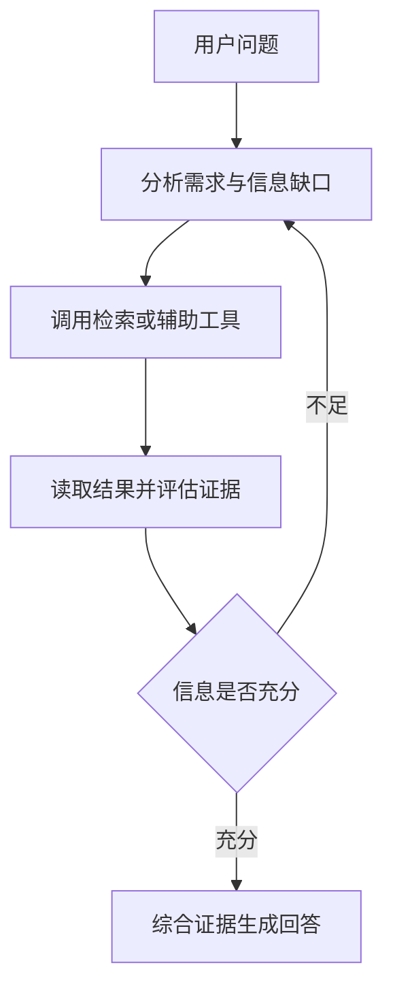

# 第三章学习笔记：知识库构建与智能体化 RAG

> 来源：李博杰《深入理解 AI Agent：设计原理与工程实践》，v2.0（2026-09-19），第三章“用户记忆和知识库”。
> 阅读范围：书内第 72-101 页，对应 PDF 文件第 80-109 页。下文页码均指书内页码。
> 本文按学习与构建顺序重排原文要点。2.6 节的数据库字段与实现流程、最后的练习顺序属于补充建议，已与教材原文原则区分；教材示例中的模型和项目名不代表已验证的当前安装配置。

## 1. 先抓住本章的主线

**先把资料变成有结构、有上下文、可追溯的知识，再让 Agent 把检索当作工具，按问题需要反复查询和验证。**

本章讨论两种持久化知识：用户记忆保存某个用户的偏好、经历和关系；共享知识库保存业务规则、技术文档等领域知识。两者共用分块、检索、压缩等技术，也都需要处理冲突、过期和权限问题。

| 内容 | 书中主要解决的问题 | 对应小节 |
| --- | --- | --- |
| 用户记忆 | 跨会话记住什么、怎样存、怎样找回 | 3.1 |
| 基础 RAG | 如何把文档变成可检索的片段，并据此回答 | 3.2 |
| 知识组织与更新 | 如何保留层次、关系、规则边界，以及持续维护 | 3.3.1-3.3.3 |
| 智能体化 RAG | 如何让 Agent 自主决定查询和后续检索 | 3.3.4 |
| 上下文感知检索 | 如何补回分块丢失的背景信息 | 3.3.5 |
| 知识发现 | 如何从大量案例中归纳决策因素和模式 | 3.3.6 |

这些方法处理不同环节，可以组合使用。它们并不是必须逐级升级、全部用上的固定阶梯。

## 2. 基础知识库怎样构建

### 2.1 区分建库阶段与问答阶段

依据 3.2、3.3.5，可将流程整理为：

```text
建库：原始文档 → 分块 → 按需补上下文前缀 → 建立向量索引和关键词索引
问答：用户问题 → 两路检索 → 结果融合 → 重排序 → 相关内容进入上下文 → LLM 生成回答
```

RAG 的基本组成是检索器和生成器：检索器找出相关资料，生成器根据这些资料回答。外部知识可以独立更新，不需要为每次知识变化重新训练大模型。（3.2，第 80-87 页）

### 2.2 第一步：把长文档切成可独立检索的片段

整篇文档只生成一个向量，会混合多个主题；检索整篇文档也容易带入大量无关内容。书中介绍三种分块方式：

| 策略 | 做法 | 主要取舍 |
| --- | --- | --- |
| 固定大小 | 按 token 数切分，并保留相邻重叠 | 简单，但可能切断段落、代码或表格 |
| 递归／结构感知 | 优先按章节、段落切分，超长时再按更小边界切 | 利用文档结构，是书中介绍的常见生产默认选择 |
| 语义切分 | 在相邻句子语义相似度明显下降处切分 | 块内主题更一致，需要额外嵌入计算 |

书中给出的调参起点是：**每块 256-1024 token，相邻块重叠 10%-20%**，再通过检索质量实测调整。它不是通用最佳参数：块太小会缺少背景，块太大则会混入多个主题。（3.2.1，第 81 页）

### 2.3 第二步：同时建立语义检索和关键词检索

**稠密检索**把文本转成向量，用相似度寻找语义接近的内容。它适合同义表达、多语言等场景，但可能漏掉必须精确匹配的代码、编号和名称。

书中以 BGE-M3 等模型说明嵌入，并比较两种近似最近邻索引：ANNOY 适合不常变化的静态数据；HNSW 支持增量更新，适合动态场景，但内存占用更高。嵌入模型与索引算法都影响质量、性能和维护成本。（3.2.2，第 82-83 页）

**稀疏检索**以关键词匹配为核心。书中的 BM25 教学实现依次进行分词、去停用词、建立倒排索引、计算词项权重。BM25 综合词的稀有程度、词频饱和与文档长度，适合精确名称和技术代码，但难以识别字面不同的同义表达。（3.2.3，第 84-85 页）

### 2.4 第三步：融合候选，再精细排序

书中推荐的混合检索流水线包含三个环节：

1. **并行召回**：稠密检索与 BM25 分别返回候选。
2. **结果融合**：将两路结果合成统一候选池。两路原始分数尺度不同，不能直接相加；书中介绍 RRF，按排名的平滑倒数求和。
3. **神经重排序**：跨编码器同时读取“查询＋候选文档”，对候选池进一步精排。

RRF 可写成 `得分 = Σ 1 / (c + rank)`。这里用 `c` 表示书中常取 60 的平滑常数，避免与返回数量 `top-k` 混淆。书中“对前 50 个候选重排序”也是示例，需要按成本和质量调整。

**融合负责形成候选池，重排序负责提高候选池中的排序质量。** 重排序不替代融合，也只能处理已经召回的内容。（3.2.4，第 86-87 页）

### 2.5 第四步：补回分块的上下文

即使切分合理，孤立片段仍可能缺少公司名、时间和章节背景，例如“该公司第二季度收入增长了 3%”。

书中的上下文感知检索，在**索引阶段**用 LLM 为片段生成简短背景前缀，然后将“前缀＋原文”一起用于向量和 BM25 索引。例如补充“ACME 公司 2025 年 Q2 财报·关键业绩指标”，让片段的主体和时间明确。

这同时改善关键词匹配与向量语义表示，代价是额外的建库调用。生成的背景仍需有原始资料支持，不能把推测写成事实。

三个概念要分清：

- **上下文感知检索**：建库时为片段补背景，提高可检索性。
- **智能体化 RAG**：运行时由 Agent 决定怎样查、是否继续查。
- **上下文感知压缩**：第二章的方法，运行时裁剪会话内容以节省窗口。

前两者可以结合使用。（3.3.5，第 96-98 页）

### 2.6 进一步展开：知识库底层数据库的构建要点

这里的“数据库构建”，指保存知识正文、版本与权限，并为向量检索和关键词检索建立可靠的数据基础。

**教材依据**：3.2 的分块与混合检索，以及 3.3.3 的“原始证据层—知识层—服务索引层”、审核发布、版本过滤和租户隔离（第 81-87、92-93 页）。**下面的表名、字段名与发布流程是据此整理的实现建议，书中没有提供这套固定数据库结构。**

#### 2.6.1 先确定各类数据放在哪里

知识库中的不同数据承担不同职责，可按下面的逻辑分工组织。它们不一定对应多个独立产品，小系统可以把部分职责合在一起。

| 数据职责 | 保存内容 | 设计重点 |
| --- | --- | --- |
| 原始证据存储 | 原始 PDF、网页快照、对话、工具结果 | 保留来源标识、校验值和定位信息，能重新核查与处理 |
| 已审核知识存储 | Markdown 条目、规则卡、统计摘要 | 保留版本、证据引用、审核结果和条目链接；可以采用教材中的 Git 管理方式 |
| 业务元数据存储 | 文档身份、版本、有效期、权限、发布状态 | 明确数据关系和约束，便于过滤、审计和恢复 |
| 向量索引 | 向量、片段 ID、必要的过滤字段 | 与指定嵌入配置和知识版本对应，负责语义召回 |
| 关键词索引 | 索引文本、词项信息、片段 ID | 保留名称、编号、术语的可检索性，负责关键词召回 |

先确定哪一层是知识的权威来源，再决定索引如何派生。向量本身不能完整替代原文、来源和审核历史；否则一旦索引损坏或模型变化，就无法可靠重建。

关系数据库也可以扩展向量检索能力。例如 pgvector 在 PostgreSQL 中提供向量存储和相似度查询；这说明元数据与向量可以放在同一数据库，并不要求起步时就维护多个服务。[pgvector 官方文档](https://github.com/pgvector/pgvector)

#### 2.6.2 先设计数据关系，再设计物理表

一个可参考的逻辑模型如下。名称仅用于说明，不要求逐项拆成独立表。

| 逻辑对象 | 主要字段示例 | 用途 |
| --- | --- | --- |
| `documents` 文档 | `tenant_id`、`doc_id`、`title`、`source_id` | 标识“哪一份文档”，避免用可变标题充当身份 |
| `document_versions` 文档版本 | `doc_id`、`version_id`、`evidence_id`、`content_hash`、`valid_from`、`valid_to`、`review_status` | 标识“哪一版内容”，保留证据、适用时间和审核状态 |
| `chunks` 文本片段 | `chunk_id`、`version_id`、`chunk_index`、`section_path`、`source_locator`、`raw_text`、`context_prefix`、`chunking_profile_id` | 保存可引用、可定位的片段，并关联原文版本和分块方式 |
| `embedding_profiles` 嵌入配置 | `profile_id`、`model_id`、`model_revision`、`dimension`、`distance_metric`、`encoding_config` | 定义向量空间以及文档／查询的编码方式 |
| `chunk_embeddings` 片段向量 | `chunk_id`、`profile_id`、`input_hash`、`vector`、`build_status` | 将向量绑定到具体片段、编码配置和实际输入 |
| `index_releases` 索引发布记录 | `release_id`、`knowledge_revision`、`profile_id`、`keyword_config_id`、`manifest`、`status` | 记录哪些已审核内容、哪些检索配置构成一个可服务版本 |
| `change_reviews` 变更审核记录 | `change_id`、`evidence_ids`、`reviewer`、`decision`、`reviewed_at` | 回答知识为什么变化、依据是什么、谁批准发布 |

关系上至少要能追溯：**向量 → 片段 → 文档版本 → 文档 → 原始证据**；一个发布版本还要能列出它使用的文档版本和索引配置。

使用关系数据库时，可用主键标识对象、唯一约束防止重复记录、外键约束防止引用不存在的版本。多租户系统的关联还应校验租户归属，避免片段错误地挂到其他租户的文档下。[PostgreSQL 约束文档](https://www.postgresql.org/docs/current/ddl-constraints.html)

#### 2.6.3 每个片段要保存哪些元数据

除正文之外，建议至少保留四组信息：

1. **身份与出处**：文档 ID、版本 ID、片段 ID、原始证据 ID、章节路径、页码或字符范围。
2. **适用范围**：租户／用户归属、访问策略标识、生效与失效时间、是否已审核并发布。
3. **处理记录**：解析配置、分块配置、上下文前缀生成配置、嵌入配置、处理状态。
4. **核对依据**：原文校验值、片段正文校验值，以及用于生成向量的实际输入校验值。

`created_at` 表示系统何时收到记录，`valid_from` 表示知识何时开始适用，两者不能混用。资料未说明生效日期时，应保留“适用时间未知”的状态，不推测日期。

用教材中的混合检索小节举例，一个片段记录可以长这样。ID 是示意命名，正文是摘要示例；这不是已经创建的数据库记录，也不是原书逐字引文：

```json
{
  "tenant_id": "personal-study",
  "doc_id": "ai-agents-textbook",
  "version_id": "v2.0",
  "chunk_id": "ch3-sec3.2.4-001",
  "section_path": ["第三章 用户记忆和知识库", "3.2.4 混合检索"],
  "source_locator": {"book_page": 86, "pdf_page": 94},
  "raw_text": "混合检索包含并行召回、结果融合和神经重排序三个阶段。",
  "context_prefix": "本段介绍教材第三章的混合检索流水线。",
  "review_status": "approved"
}
```

向量可放在独立记录中，通过 `chunk_id` 与此片段关联。**向量生成成功和内容审核通过是两个状态；完成全部索引与发布检查后，该版本才进入服务范围。**

#### 2.6.4 导入流程：把文件处理成可验证的数据

可把一次导入分成以下步骤：

1. **登记来源**：记录文件身份、版本、获取时间、权限与校验值；相同文件重复导入时能识别出来。
2. **解析正文**：提取标题、段落、表格和页码定位；扫描件需要识别文字，复杂表格需检查行列关系是否保留。
3. **清理噪声**：处理重复页眉页脚、断行和明显乱码，但保留否定词、单位、日期、编号和条件。
4. **检查内容质量**：发现矛盾、无法识别的表格或不完整正文时，标记待核查，避免把解析错误当成知识。
5. **结构感知分块**：保存片段顺序和章节路径；必要时保留与父章节、相邻片段的关联。
6. **补上下文与知识提炼**：生成有证据支持的背景前缀；按需求增加摘要、规则卡或统计结果，并保留原文引用。
7. **构建与验收索引**：生成向量和关键词索引，检查完整性与典型查询，通过后发布。

去重需要区分“重复上传”“不同版本”和“不同来源的相同表述”。内容相同，也可能有不同权限或来源，不能只按正文相同就合并业务记录。可共享底层文件存储，但应保留各自的来源与访问关系。

#### 2.6.5 向量配置必须一致并可追溯

这里有两种一致性：

- **向量空间一致**：文档向量与查询向量必须使用兼容的模型和编码规则。维度相同，不代表两个模型的向量可以互相比较。
- **内容对应一致**：向量必须对应当前记录声明的正文、上下文前缀和配置。更新正文后仍沿用旧向量，会出现“命中的是旧语义，展示的是新内容”的错配。

因此，嵌入配置要记录模型身份、可获得的版本标识、输出维度、距离度量，以及查询／文档编码时的必要处理方式。用于索引的输入如果是“上下文前缀＋原文”，其校验值也应覆盖这两部分。

换模型、改变编码方式或更改前缀／正文时，要判断哪些向量需要重算；不要把不兼容的向量直接混入同一个检索空间。可先构建新配置对应的索引，验证后切换服务版本。

向量数据库支持的距离度量和索引配置要与查询一致，不能只保存一个向量数组便认为配置完成。[pgvector 距离与索引说明](https://github.com/pgvector/pgvector#querying)

#### 2.6.6 数据库需要哪些索引

至少分清三类索引：

| 索引类型 | 服务的需求 | 需要检查的问题 |
| --- | --- | --- |
| 业务／元数据索引 | 按租户、文档、版本、状态、时间查找与过滤 | 常用过滤是否有合适索引，片段是否能快速关联原文 |
| 向量索引 | 找语义接近的片段 | 采用精确还是近似检索，召回率、延迟与内存是否满足要求 |
| 关键词索引 | 找名称、编号和明确术语 | 中文分词、大小写、连字符、停用词是否破坏关键信息 |

起步时可用精确检索作为质量对照，数据规模和查询延迟需要时再引入近似索引。近似索引是在速度与召回之间取舍，建索引后应重新评估命中质量。[pgvector 索引说明](https://github.com/pgvector/pgvector#indexing)

关键词侧尤其要检查“HTTP-403”“会员编号”和专业词是否被不合适的分词拆散。“支持全文搜索”并不等于已复现书中的 BM25 流水线，需核对实际分词和评分方法。

两路索引最好共用片段身份和发布范围，融合时按片段 ID 去重；重叠分块可能返回相似正文，可再按文档与章节组织结果，避免把上下文窗口耗在重复片段上。

#### 2.6.7 更新、失败重试与发布要一起设计

**幂等**表示同一份输入重复处理，不会重复增加相同业务记录。可通过稳定身份、唯一约束、输入校验值和任务状态实现。片段身份可以包含租户、文档版本、分块配置和块序号；配置或输入发生变化时，应形成明确的新处理版本。

发布流程可设计为：

```text
已审核知识变更
→ 确定受影响的文档、片段与摘要
→ 在待发布版本中生成新片段和索引
→ 检查向量、关键词、权限及来源是否完整
→ 回放典型查询
→ 切换当前服务版本
→ 保留上一版以便回滚
```

向量服务和关键词服务分开部署时，不能因为一路完成就暴露新版本。可用发布清单记录两路索引是否准备好，让一次请求固定使用同一组知识和索引版本；任何一步失败，都继续服务上一完整版本。

单库内的关联修改可利用事务；跨服务发布仍需显式协调，不能假设它们共享一个事务。替换文档时，也要处理旧片段的下线和依赖摘要的刷新，避免新旧内容同时被当成现行知识。

#### 2.6.8 权限与有效期要成为检索条件

根据教材第 93 页，检索范围应同时满足调用者权限、租户／用户归属和知识有效性。实现时建议由服务端根据已验证身份生成过滤条件；Agent 可以提出业务查询，不能自行声明“我有管理员权限”。

过滤至少考虑：当前发布版本、所属租户、访问策略、审核状态，以及已知的适用时间。原文、摘要、相邻片段读取和结果缓存也要遵守同一权限范围，防止“搜索受限，但按 ID 读全文不受限”。

向量数据库的元数据条件可以组合匹配；例如 Qdrant 的过滤机制支持多个条件共同限制结果范围。但过滤表达式不会自动替你设计用户权限，访问策略仍需由应用正确提供。[Qdrant 过滤文档](https://qdrant.tech/documentation/search/filtering/)

还要检查**过滤后的召回数量**。某些近似索引的实现先扫描候选再过滤，结果可能少于要求的 `top-k`；pgvector 官方文档明确说明了这种情况。应在正确的权限条件下调整检索策略、增加搜索范围或按数据特点分区，而不是取消权限限制。[pgvector 过滤说明](https://github.com/pgvector/pgvector#filtering)

#### 2.6.9 查询时怎样把数据库记录交给 Agent

可采用下面的读取路径：

1. 验证调用者身份，确定允许访问的知识范围和当前服务版本。
2. 使用该版本对应的嵌入配置编码查询，同时执行关键词检索。
3. 在两路检索中应用一致的范围限制，融合候选并按片段身份去重。
4. 对候选精排，再读取与该版本一致的正文；需要邻块或父章节时，再次核对权限。
5. 返回正文、文档标题、片段 ID、知识版本、来源定位，以及适用时间或冲突状态。

不要只返回正文字符串。Agent 有了片段身份和来源，才能引用依据、查看更完整的上下文，以及在多轮检索中知道哪些材料已经读过。

片段被检索命中，只表示与查询相关，并不自动说明它仍然有效或足以回答问题。关联资料不足、证据冲突和字段缺失，应保留为可观察的状态，供 Agent 继续查询或澄清。

#### 2.6.10 容量、恢复和验收怎样做

先估算片段数量、平均长度、向量维度、更新频率和查询并发。若向量采用 32 位浮点，**仅向量数值部分**约占 `片段数 × 维度 × 4 字节`；例如 10 万个 1024 维向量约 391 MiB。这不包含索引结构、正文、元数据、数据库开销和副本，不能直接当作总内存需求。

备份应覆盖权威知识、原始证据引用、权限、版本和配置；检索索引可以备份，也应有经过验证的重建流程。恢复验收要确认不仅文件能打开，而且原来的查询仍能找到相应知识。

构建完成后，建议逐项验收：

- [ ] 文档、版本、片段都有明确身份，引用关系和租户归属正确。
- [ ] 每个应服务的片段都能回到原始来源，章节与页码定位准确。
- [ ] 重复导入同一输入不会产生重复记录；失败任务可以安全重试。
- [ ] 向量维度和编码配置正确，没有将不同模型的向量混用。
- [ ] 向量输入与当前正文、上下文前缀一致，没有内容错配。
- [ ] 向量与关键词索引覆盖当前发布清单，未完成构建的版本不可服务。
- [ ] 已失效资料退出默认检索范围，历史查询可以明确指定版本或时间范围。
- [ ] 搜索、按 ID 读取、相邻片段读取和缓存都不能越权或跨租户。
- [ ] 权限过滤后仍有可接受的召回质量，不能只测无过滤查询。
- [ ] 同义表达、精确编号、跨章节问题和冲突记录均有测试查询。
- [ ] 记录命中率／召回率、排序质量、查询延迟、构建耗时和资源用量。
- [ ] 已实际验证回滚与恢复，能够从已审核知识重新构建服务索引。

学习阶段可以先实现“文档及版本—片段—嵌入配置—向量—发布记录”这条基本链路，再依据实际问题加入复杂图谱或独立检索服务。重点是保证来源可追溯、内容与向量一致、检索范围正确，并能可靠更新。

## 3. 知识库怎样组织，才能超越零散文本

### 3.1 原始案例入库之前，要提炼可用知识

书中用两个例子说明，单纯存入原始案例还不够：

- **全局统计**：只召回部分猫的案例，不能可靠计算全库黑猫与白猫的比例；应预先生成准确的统计摘要并索引。
- **规则边界**：零散客服工单只记录个案结果，可能缺少“适用于谁、哪些人不适用”的完整规则；应结合全库证据提炼带适用边界的规则卡。

关键工作发生在索引之前：归纳、抽象、保留条件与边界。增加 `top-k` 无法补出原文中从未明确表达的规则。（3.3.1，第 88 页）

### 3.2 按问题类型选择组织方法

| 方法 | 构建方式 | 擅长的问题与限制 |
| --- | --- | --- |
| 基础混合检索 | 对片段建立稠密／稀疏索引，并重排序 | 寻找某项信息的具体片段，能覆盖多数基础需求 |
| RAPTOR | 片段作为叶子；语义聚类；LLM 生成父层摘要；递归形成知识树 | 从整体概念逐步深入细节、跨层综合 |
| GraphRAG | 提取实体和关系；构建图谱；发现社区并生成摘要 | 多跳关系、实体消歧；三元组可能丢失条件和时间语义 |
| 文件系统范式 | 用目录、条目、摘要、索引和交叉链接组织知识 | 便于阅读、编辑、版本管理，以及 Agent 按路径导航 |

RAPTOR 与 GraphRAG 会增加构建和查询成本；书中强调，只有经常需要跨文档综合、多层导航或关系推理时，才值得投入。完整自然语言应保留，结构化元数据和图谱可作为补充索引。（3.3.1，第 89-90 页）

### 3.3 Markdown 知识库必须有摘要、入口和横向链接

书中以 OpenViking 说明按需加载的三层表示：

- **L0 摘要**：约 100 token，快速判断相关性。
- **L1 概览**：约 2000 token，支持规划与决策。
- **L2 全文**：需要深入时再读取原始内容。

层次摘要解决纵向导航；条目之间的交叉链接、入口页和索引页解决横向导航。只是把 Markdown 文件堆进目录，仍会形成知识孤岛。

书中要求写入新条目时，先查找并链接相关已有条目，同时更新目录索引，形成双向可达的引用网络。纯文本知识还可以通过 Git 审查、追溯和回滚。（3.3.2，第 91 页）

## 4. 智能体化 RAG 怎样构建

### 4.1 核心变化：检索由 Agent 主动调用

| 对比点 | 传统 RAG | 智能体化 RAG |
| --- | --- | --- |
| 检索触发 | 固定的问答前置步骤 | Agent 按信息需求调用工具 |
| 查询组织 | 通常直接使用用户问题 | 分解子问题、改写关键词、追查关系 |
| 结果处理 | 一次检索后生成回答 | 观察结果，判断信息缺口，必要时继续检索 |
| 成本与用途 | 流程简洁，适合明确单一的问题 | 更多调用和延迟，适合复杂、多跳问题 |

**智能体化的关键是 Agent 拥有检索决策权，不是把搜索次数固定增加到两次或三次。** 简单问题仍可以一次查完。（3.3.4，第 93-95 页）

### 4.2 书中的系统组成与循环

书中的图 3-13 将系统分为 Agent、工具层和可切换的知识库后端。构建顺序可整理为：

1. **先建可用的检索后端**：混合检索、结构化索引或上下文感知检索，都可以作为后端。
2. **将检索封装成工具**：书中的名称是 `knowledge_base_search`。同一 Agent 还可以调用 `web_search`、`code_interpreter` 等辅助工具。
3. **接入 ReAct 循环**：分析需求，调用工具，读取返回结果，再评估信息是否充分。
4. **根据信息缺口调整查询**：需要时分解子问题、搜索关联条款、核对条件或冲突记录。
5. **证据充分后综合回答**：将多轮获取的信息组织成有依据的结论。



实验 3-8 的复杂司法问答示例，先检索各子问题，再追查它们之间的关系；首次命中若干相关片段后，Agent 仍会检查是否遗漏关键联系。教材借此说明迭代检索的价值，并未要求所有问题都走复杂流程。（第 94-95 页）

### 4.3 检索资料必须保持“数据”的身份

外部文档可能包含提示注入或被投毒的知识。书中提出两层边界：检索结果要标注来源、明确它是参考资料；转账、删除、发信等动作要经过独立授权判断，不能只因文档中的文字而执行。（3.3.4，第 94 页）

## 5. 知识库怎样持续更新

### 5.1 分开原始证据、审核知识和服务索引

| 层次 | 保存的内容 | 作用 |
| --- | --- | --- |
| 原始证据层 | 对话、运行轨迹、原始文档 | 保留原始来源，支持核查 |
| 知识层 | 提炼后的 Markdown、规则或代码 | 可修订、可审核、可版本管理 |
| 服务层 | 分块、摘要、向量及其他检索索引 | 从已审核版本生成，可重建 |

**已审核的知识是来源，检索索引是派生物。**（3.3.3，第 92 页）

### 5.2 增量更新：把知识变更当作 PR

新证据到来后，书中采用“提议者—审核者”流程：

1. Proposer Agent 搜索已有知识，在工作分支提出最小、完整的修改，同时维护链接、时间和证据引用。
2. Reviewer Agent 独立对照旧知识、差异和原始证据，检查断言、限定条件、冲突及过度改写。
3. 双方按具体反馈迭代；设置迭代或成本上限，未收敛时转人工审核。
4. 批准并通过格式、链接、元数据、权限等检查后合入，再重建受影响的索引。

书中特别强调：这两个角色应有主动搜索、追溯和检查能力，不只是两次固定的摘要调用。优先使用能力相近、来自不同模型家族的 Agent，并限制各角色的写入权限。审核者应能在授权范围内查完整证据，不能只看提议者选出的片段。（第 92 页）

### 5.3 定期整理：回到原始数据重审全库

周期整理包括去重、去旧、合并、调整目录和链接，以及核对摘要是否遗漏事实、否定词或时间条件。大型库可分批处理，但需要覆盖清单。

冲突不能简单按“最新一条”覆盖：先确认是否在不同时间、对象或条件下分别成立；证据不足时保留冲突和待确认状态。全量整理也要经过审核，再重建索引、回放典型检索与问答用例。

检索时还要利用版本、生效／失效时间过滤旧知识，并按调用者权限、租户范围过滤资料，避免越权内容进入上下文。（第 93 页）

## 6. 怎样把同一套技术用于用户记忆

用户长期记忆是从对话中提炼的稳定信息；原始对话轨迹是可追溯的事件记录。两者用途不同。记忆提取遵循选择性、抽象化和结构化。（3.1，第 72-75 页）

书中的四种格式，从简单到复杂为：

| 格式 | 特点 |
| --- | --- |
| Simple Notes | 单条原子事实，便宜，但关联容易丢失 |
| Enhanced Notes | 完整叙事段落，语义完整，但冗余、更新复杂 |
| JSON Cards | 分类字段，支持局部更新，但分类可能过于刚性 |
| Advanced JSON Cards | 加入背景、主体、关系和时间，便于消歧，维护成本较高 |

实验 3-9 将完整对话历史作为知识库，给 Agent 配置 `search_user_memory` 工具。用户有两辆车时，Agent 可沿首次结果中的线索继续检索另一辆车，而不是随意猜测。但孤立对话块仍可能难以表达连续修改和时间关系。（第 95-96 页）

本章最终汇合为**双层记忆架构**：少量关键事实用 Advanced JSON Cards 常驻上下文，提供全局概览；大量原始对话用上下文感知检索按需召回，提供精确细节。

两层配合，既有机会发现跨会话关联，也能回到原始记录验证。书中据此划分三个验收层次：基础回忆、多会话检索、主动服务。（第 73-74、97-98 页）

另外，书中讨论了可执行记忆：把状态写成带类型对象、把聚合和约束写成函数，减少让 LLM 做精确统计或规则检查的负担。它是另一种知识表示选择，不是构建基础 RAG 的必选项。（3.1.4，第 76-77 页）

## 7. 怎样判断构建效果

书中要求在带标注的测试查询集上衡量检索质量，并通过组件对比观察各环节的贡献。（3.2.4，第 87 页；实验 3-8，第 95 页）

| 指标／对比 | 关注点 |
| --- | --- |
| 书中的 `recall@k` | 前 k 个结果是否至少命中一篇相关文档 |
| MRR | 第一个相关结果是否排得足够靠前 |
| nDCG | 整个结果列表的相关程度和排序质量 |
| 传统分块 vs 上下文感知分块 | 补背景后是否更准确命中主体、时间与意图 |
| 传统 RAG vs 智能体化 RAG | 简单／复杂问题上的质量与响应成本差异 |

**指标口径要注意**：第 87 页脚注明确，书中 `recall@k` 实际采用命中率（hit rate／success@k）；标准召回率是“召回的相关文档数 ÷ 全部相关文档数”。多篇相关文档场景下，两者不同。

书中引用的效果与成本属于相应研究或实验条件，不应直接作为自己系统的效果保证。尤其需要检查多跳问题、冲突记录、失效知识和权限过滤，而不只看几个成功回答。

## 8. 建议的学习与练习顺序

以下根据本章内容整理，不是书中逐字给出的部署步骤：

1. **先做基础问答库**：结构感知分块，接入稠密检索、BM25、融合和重排序，建立可核对的查询集。
2. **补足片段背景**：加入上下文前缀，用同一查询集比较前后差异。
3. **改善知识组织**：增加统计摘要、规则卡、入口和链接；确有层次或关系需求时再加入 RAPTOR／GraphRAG。
4. **把搜索交给 Agent**：封装检索工具，接入 ReAct，让它根据缺失信息迭代查询。
5. **加入维护流程**：保存证据、版本和权限信息，让更新经过审核，再发布派生索引。
6. **扩展到用户记忆**：结合常驻事实概览与按需对话检索，按三个记忆层次评估。

教材相关实验：3-4 `dense-embedding`、3-5 `sparse-embedding`、3-6 `retrieval-pipeline`、3-7 `structured-index`、3-8 `agentic-rag`、3-9 `agentic-rag-for-user-memory`、3-10 `contextual-retrieval`、3-11 上下文感知用户记忆。

本章还有两项进阶内容：从案例数据中提取标准化 JSON，进行因子分析与聚类，形成可供 Agent 使用的决策模式（实验 3-12，第 98-99 页）；以及多模态记忆的探索（第 100 页）。前者强调知识发现，后者涉及原始媒体、嵌入或特定模型结构，不宜当作基础文本 RAG 的必备步骤。
